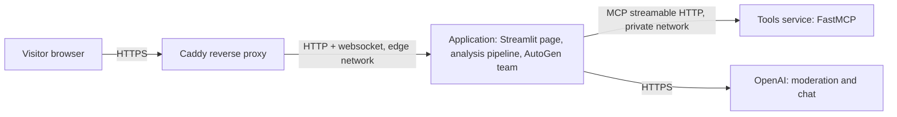
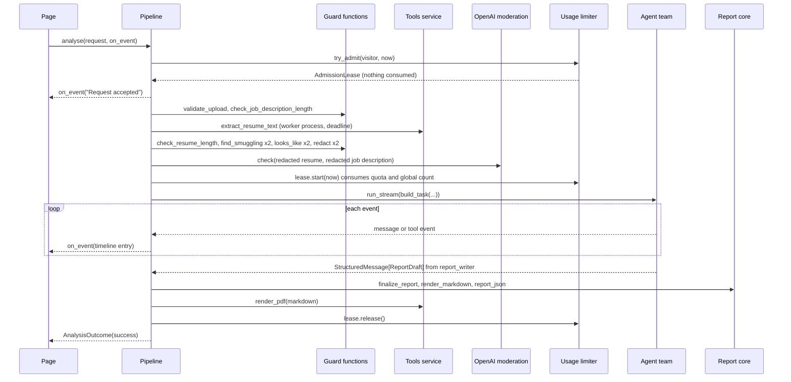
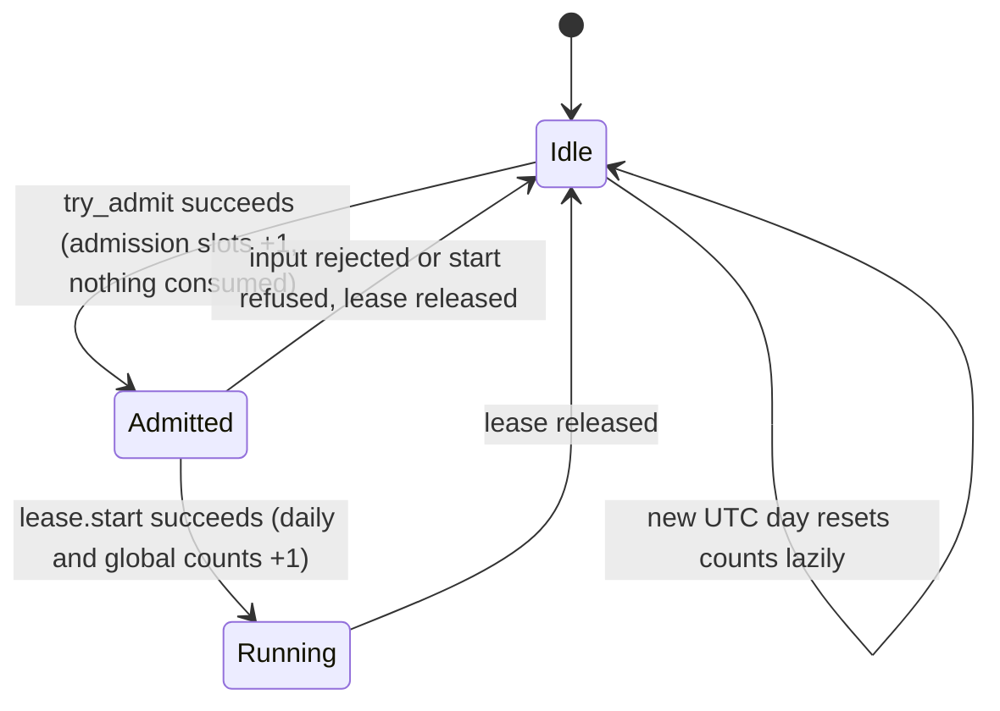

<!-- sarathi:artifact-format version="2" -->
# ResumeFit AI — Software Design

## Technical Approach

### The essential model

ResumeFit AI is two small Python services behind a reverse proxy on one VPS:

1. **The application** — a Streamlit page that also runs the analysis. It
   validates inputs, removes contact details, applies usage limits, runs an
   AutoGen agent team in-process, validates and scores the final report, and
   renders it. It is the only component that holds the OpenAI key.
2. **The tools service** — a FastMCP server with three tools: extract text from
   an uploaded resume, normalise skill names, and render Markdown to PDF. It
   holds no secrets, has no internet egress, and is reachable only on a private
   Docker network. Untrusted file parsing therefore happens in a process that
   has nothing worth stealing.

Caddy terminates HTTPS for the public domain and overwrites the client-address
headers with the connecting address; the application trusts only that header.
There is no database, no separate API service, and no user account store.



### How one analysis runs

A deterministic pipeline does everything that can be decided without a model
**before** any paid call. It first takes a non-consuming admission lease (one
slot per visitor, three overall, and a check that quota remains), so floods of
requests cannot fan out into parsing or moderation work. Then come file checks,
text extraction (through the tools service, in a killable worker process with
a deadline), length limits, instruction-smuggling and plausibility checks,
contact redaction, and moderation. Only then does the lease consume one
analysis from the daily quota and the agent team start; it only ever sees
redacted text wrapped in explicit data markers. The pipeline emits a sanitised
timeline entry for every stage and tool call from the first moment, so the
visitor sees progress within a second.

The team is an AutoGen `SelectorGroupChat` arranged as a hub: after every
specialist turn the orchestrator speaks again and names the next specialist on
a `NEXT: <agent>` line; a small selector function reads that line, so no extra
model call is spent on speaker selection. Specialists reply with typed
structured output (Pydantic models via `output_content_type`). The Resume
Parser, JD Analyst, and Matcher can call the `normalize_skills` MCP tool. The
run ends when the Report Writer answers, or when a message, time, or token
limit trips.

After the team finishes, the pipeline validates the Report Writer's draft,
computes the two skill-coverage rubric criteria and the total score itself,
strips any active content from every string, renders Markdown, and asks the
tools service for a PDF. An invalid draft gets exactly one standalone retry of
the Report Writer, only if the single per-analysis token budget (shared by the
team, tool reflection, and the retry) can still cover it. Every outcome
becomes one structured log event and, for failures, a fixed plain-language
message with a support ID. The model client and MCP sessions of an analysis
are opened in one `AsyncExitStack` and always closed in `finally`.

### Why this shape

- It satisfies the assignment (orchestrator, five specialists, skill files, MCP
  tools, structured output) with the least moving parts the brief allows.
- Decisions that must be predictable — rejection rules, quotas, the score
  arithmetic, sanitisation — live in plain functions that are unit tested,
  not in prompts.
- A verified dependency fact forces two dependency sets: AutoGen's MCP adapter
  (autogen-ext 0.7.5) imports symbols that no longer exist in `mcp` 2.x, while
  FastMCP 4 requires `mcp` 2.x. The two containers already have separate
  images, so each keeps its own pinned set, and a cross-process contract test
  proves they interoperate (both protocol stacks were exercised together while
  preparing this design).

### Evolution

Likely next steps — shared limits across processes, a model-based injection
classifier, accounts — each have an obvious seam (the limiter, the guard
functions, the access gate) and are deliberately not built now.

## Overview

- **Context:** greenfield product; see `docs/spec.md` for accepted intent.
- **Scope:** the whole system — application, tools service, deployment.
- **Readiness:** every component, interface, data shape, failure category, and
  test obligation below is specified; nothing blocks an implementation plan.
- **Review depth:** Standard, plus security, privacy, and external-integration
  checks, as recorded in `.sdlc/process-decisions.yaml`.

Work Scope: product/system
Ready To Implement: Yes
Review Level: Standard
Extra Checks: security, privacy, external-integration

## Tech Stack

Versions below were installed and exercised on 2026-09-30 (Python 3.11.9,
Windows) while preparing this design.

| Area | Choice and pinned version | Verified facts relied on |
| --- | --- | --- |
| Runtime | Python 3.11 (local 3.11.9; images `python:3.11-slim`) | — |
| Agent framework | `autogen-agentchat==0.7.5`, `autogen-core==0.7.5` | `AssistantAgent(name, model_client, tools=, system_message=, output_content_type=, max_tool_iterations=, reflect_on_tool_use=)`; structured output yields `StructuredMessage[Model]` and raises `pydantic.ValidationError` on invalid JSON; `SelectorGroupChat(participants, model_client, termination_condition=, max_turns=, selector_func=, custom_message_types=)`; `custom_message_types=[StructuredMessage[Model], ...]` is **required** or the team fails with "Message type ... is not registered"; team errors surface from `run_stream` as `RuntimeError`; `TaskResult(messages, stop_reason)`; conditions `SourceMatchTermination`, `MaxMessageTermination`, `TimeoutTermination`, `TokenUsageTermination(max_total_token=)` combine with `|`. |
| Model client | `autogen-ext[openai,mcp]==0.7.5` → `OpenAIChatCompletionClient(model=, api_key=, temperature=, timeout=, max_retries=, max_tokens=)`; `openai>=1.93,<4` (3.22.1 installed) | Default model `gpt-4o-mini`. `max_tokens` is accepted as a per-call create argument; `total_usage()` returns usage summed over every call on that client; `close()` releases the HTTP client (all verified). Moderation through `openai.AsyncOpenAI().moderations.create(model="omni-moderation-latest", input=[...])`. |
| Test double for models | `autogen_ext.models.replay.ReplayChatCompletionClient(chat_completions, model_info=)` | Accepts strings and `CreateResult` objects (including `FunctionCall` content and explicit `RequestUsage`), so tool calls, structured replies, and token-limit trips can be scripted. |
| MCP client (application) | `autogen_ext.tools.mcp`: `StreamableHttpServerParams(url, timeout, ...)`, `McpWorkbench(server_params)` (async context manager) with `call_tool(name, arguments)`, `create_mcp_server_session(params)` (async context manager yielding a `ClientSession`), `mcp_server_tools(params, session=)`; **`mcp>=1.11,<2`** (1.30.0 installed) | With `mcp` 2.2.0 the adapter import fails (`RequestContext` missing); with 1.30.0 it talks to a FastMCP 4 server correctly. `McpWorkbench` has no tool filter, so agents get only a filtered adapter list from `mcp_server_tools` bound to one explicit session. |
| MCP server | `fastmcp==4.0.10` (brings `mcp==2.2.0`) | `@mcp.tool` functions; `@mcp.custom_route("/health", methods=["GET"])`; `mcp.run(transport="http", host=, port=, stateless_http=, allowed_hosts=)` serves `/mcp`; `mcp.http_app()` works with Starlette `TestClient`; `fastmcp.Client(mcp)` calls tools in-process and returns `CallToolResult(data, structured_content, is_error)`. |
| Document parsing and PDF | `pypdf==6.19.0`, `python-docx==1.2.0`, `fpdf2==2.8.9` (tools service only) | Core PDF fonts are Latin-1 only. |
| Web UI | `streamlit==1.64.0` | `st.file_uploader(label, type=, max_upload_size=)`; `st.context.headers`, `st.context.ip_address` (None on localhost; docs warn it is spoofable); `st.status`, `st.download_button`; `streamlit.testing.v1.AppTest.from_file(path, default_timeout=)` with `file_uploader[i].set_value((name, bytes, mime))`. Defaults that must be overridden: `browser.gatherUsageStats=true`, `client.showErrorDetails="full"`, `server.maxUploadSize=200`. `server.enableCORS=true` is the protective setting and must stay on. |
| Data models | `pydantic>=2.12,<3` (2.13.5) | — |
| Reverse proxy | Caddy 2 (`caddy:2-alpine` image) | We do not rely on Caddy's default forwarding: the Caddyfile sets `header_up X-Real-IP {remote_host}` and `header_up X-Forwarded-For {remote_host}`, overwriting any client-supplied values on every proxied request. |
| Tests and lint | `pytest==9.1.1`, `pytest-asyncio==1.4.0` (`asyncio_mode = "auto"`), `ruff`, `mypy`, `pre-commit`, `pyyaml` (deployment-file checks) | — |
| Deployment | Docker Compose v2 on a Linux VPS | Not available locally; files are checked statically, and CI runs `docker compose config` and builds both images. |

## Drivers & Constraints

- **Cost and abuse on a public URL** drive the order of the pipeline (all cheap
  checks first), the in-process limiter, and the per-run message, time, and
  token caps.
- **Personal data** drives redaction before any OpenAI call, memory-only
  handling, content-free logs, a read-only container filesystem, and output
  sanitisation.
- **Instruction smuggling** drives three layers: pattern rejection, data
  markers plus explicit rules in every skill file, and deterministic scoring so
  an injected "give 100" cannot change the arithmetic.
- **Untrusted files** drive parsing inside the isolated tools container, in a
  killable worker process with a wall-clock deadline, at most two at a time,
  with page, size, and archive caps and no egress.
- **Assignment constraints** fix the agent roster, skill files, MCP boundary,
  and structured output.
- **Simplicity** rules out FastAPI, databases, queues, and accounts. Limits are
  in memory because there is one application process on one VPS.
- **Testability without a key** requires dependency injection of the model
  client, moderation client, and tools gateway into the pipeline.
- **No local Docker** means deployment correctness is argued by static tests
  and a manual post-deploy checklist.

## Structure and Layers

Dependencies point inward, from I/O toward plain decision code:

- **Presentation** — the Streamlit page. It derives the visitor key from the
  proxy's trusted header, runs the access gate, collects inputs, calls the
  pipeline, and renders results. It holds no business rules.
- **Orchestration shell** — the analysis pipeline. It sequences the stages,
  owns the admission lease on the limiter and the per-analysis resource stack,
  runs the agent team, handles the token budget, retries, and failure
  categories, and emits timeline and log events.
- **Decision core** — guard functions, limiter policy, report finalisation and
  rendering, timeline mapping, and the speaker-selection function. No network,
  no clock (time is passed in), no files except reading the bundled pattern
  catalogue and skill files at start-up.
- **Adapters** — the MCP tools gateway, the OpenAI model-client factory, and the
  moderation adapter. Each is a thin wrapper with a small protocol so tests can
  substitute it.
- **Tools service** — a separate process with its own core (extraction,
  taxonomy, PDF layout) behind the MCP tool functions.

### Source tree

```text
resumefit-ai/
  README.md
  .env.example
  .gitignore
  pyproject.toml                  ruff, mypy, and pytest settings
  .pre-commit-config.yaml         fast Ruff hook
  .github/workflows/check.yml     CI: local-gate mirror plus Docker config/build job
  scripts/check.py                local quality gate (lint, types, both test suites)
  docker-compose.yml
  Caddyfile
  app/
    Dockerfile
    .dockerignore                 build context is ./app
    requirements.txt
    requirements-dev.txt
    .streamlit/config.toml
    streamlit_app.py              page entry point
    skills/                       one Markdown skill file per agent
      orchestrator.md
      resume_parser.md
      jd_analyst.md
      matcher.md
      coach.md
      report_writer.md
    resumefit/
      __init__.py
      config.py                   Settings.from_env
      observability.py            JSON logging, support IDs, visitor keys, client IP
      outcomes.py                 request, timeline entry, outcome, failure categories
      schemas.py                  Pydantic models (model-facing and final report)
      report.py                   finalise, sanitise, score, Markdown, JSON
      limits.py                   UsageLimiter and AccessGate
      guardrails/
        __init__.py
        uploads.py                type, signature, size checks
        text_checks.py            length bounds, smuggling, plausibility
        injection_patterns.txt    maintained pattern catalogue
        pii.py                    contact-detail redaction
        moderation.py             OpenAI moderation adapter
      adapters/
        __init__.py
        tools_gateway.py          MCP calls and agent tool list
        models.py                 OpenAI chat client factory
      agents/
        __init__.py
        skills.py                 skill-file loading
        team.py                   agents, selector, termination, task text
        timeline.py               AutoGen events to timeline entries
      pipeline.py                 run_analysis and analyse
      ui.py                       Streamlit rendering helpers
    tests/
      conftest.py
      fixtures/                   sample texts, smuggling and legitimate corpora
      test_*.py
  mcp_server/
    Dockerfile
    .dockerignore                 build context is ./mcp_server
    requirements.txt
    requirements-dev.txt
    resumefit_tools/
      __init__.py
      server.py                   FastMCP app, tools, health route, entry point
      extraction.py               type detection and text extraction with caps
      worker.py                   killable extraction process, deadline, slot cap
      taxonomy.py                 skill normalisation
      taxonomy.json               canonical skills and synonyms
      pdf_render.py               Markdown subset to PDF
    tests/
      conftest.py                 generates PDF, DOCX, hostile fixtures at run time
      test_*.py
```

## Components

### Streamlit page
<!-- sarathi:component id="COMP-UI" realizes="FR-PRIVACY-NOTICE FR-PRIVACY-CLEAR FR-PROGRESS-TIMELINE FR-PROGRESS-STATUS FR-REPORT-DISPLAY FR-REPORT-JSON FR-REPORT-MARKDOWN FR-REPORT-PDF FR-REPORT-PDFFALLBACK FR-ACCESS-CODE FR-ERROR-SAFE NFR-A11Y-FORMS UC-ANALYSIS-RUN UC-REPORT-DOWNLOAD UC-ACCESS-UNLOCK" uses="IFACE-PIPELINE IFACE-LIMITS IFACE-REPORT IFACE-CONFIG" -->

`app/streamlit_app.py` with helpers in `app/resumefit/ui.py`. One column:
title and one-line purpose; privacy notice (what is sent to OpenAI, what is
redacted, nothing stored, link to OpenAI's API data policy); access-code form
when configured; file uploader (`type=["pdf","docx","txt"]`, 2 MB); job
description text area with a live character count; "analyses left today";
**Analyse** button (disabled while running, via an `on_click` callback that
sets `running` in `st.session_state` before the rerun that performs the work);
an `st.status` container that receives timeline entries; the result sections;
three download buttons; **Start over**.

All report strings pass through `ui.escape_markdown` before display; no call
uses `unsafe_allow_html`. The score is shown as text ("72 / 100") plus a
progress bar. The whole action handler is wrapped so any exception becomes the
generic message with a support ID. Singletons (settings, limiter, access gate)
are created with `st.cache_resource`. The visitor key is
`visitor_key(client_identity(st.context.headers, st.context.ip_address,
settings), secret)`; the same key feeds the limiter and the access gate.
Session state holds only `unlocked`,
`running`, `timeline`, and `outcome`; **Start over** deletes them.

### Analysis pipeline
<!-- sarathi:component id="COMP-PIPELINE" realizes="FR-COST-ADMISSION FR-GUARD-NOSPEND FR-REPORT-RETRY FR-ERROR-SAFE FR-COST-STOP FR-PRIVACY-NOSTORE FR-OPS-LOGS FR-PROGRESS-TIMELINE FR-REPORT-PDFFALLBACK UC-ANALYSIS-RUN NFR-PERF-DURATION NFR-PERF-FEEDBACK NFR-COST-TOKENS NFR-TEST-OFFLINE" uses="IFACE-GUARDS IFACE-LIMITS IFACE-REPORT IFACE-TEAM IFACE-GATEWAY IFACE-CONFIG" -->

`app/resumefit/pipeline.py`. `run_analysis` sequences the stages described in
Key Flows. It takes the admission lease first and releases it in `finally`,
emits pipeline timeline entries through the caller's `on_event` callback
before and after every stage and app-side MCP call, streams team events as
further entries, enforces a hard `asyncio.timeout` of the configured analysis
timeout plus 15 seconds, performs the single report retry, maps every
exception to a failure category, and writes exactly one `analysis_finished`
log event. `analyse` builds the real dependencies from settings and calls
`run_analysis`; the page calls `analyse`.

**Resource lifecycle.** Each analysis opens one `contextlib.AsyncExitStack`:
the tools gateway (`await stack.enter_async_context(deps.tools_factory())`,
which holds one `McpWorkbench` and one agent-tool session) and the model
client (`stack.push_async_callback(client.close)` immediately after
creation). The stack is closed in `finally` on success, failure, timeout, and
`asyncio.CancelledError` (which is re-raised after cleanup), so no client or
MCP session outlives its analysis or is shared across Streamlit sessions or
event loops.

**Token budget.** One budget of `MAX_TOTAL_TOKENS` covers the team, tool-result
reflection, and the report retry: all use the same per-analysis model client,
and spent tokens are `client.total_usage()` (prompt plus completion). Every
call is capped by `max_tokens=MAX_OUTPUT_TOKENS_PER_CALL` (default 4,000), so
the team's `TokenUsageTermination` can overshoot by at most one call. Before
the retry the pipeline estimates its cost as the retry prompt's characters
÷ 3 plus the per-call output cap; if the remaining budget is smaller, the
retry is skipped and the outcome is `report_invalid` with `retry_skipped`.

### Guard functions and moderation adapter
<!-- sarathi:component id="COMP-GUARDRAILS" realizes="FR-UPLOAD-TYPES FR-UPLOAD-SIGNATURE FR-UPLOAD-SIZE FR-UPLOAD-TEXTLEN FR-INPUT-JDLEN FR-GUARD-INJECTION FR-GUARD-RESUMESHAPE FR-GUARD-JDSHAPE FR-GUARD-MODERATION FR-GUARD-FAILCLOSED FR-PRIVACY-REDACT NFR-GUARD-ACCURACY NFR-SEC-INJECTION" -->

`app/resumefit/guardrails/`. Pure functions except `moderation.py`:

- `uploads.validate_upload(filename, data)` — extension allow-list
  (`.pdf`, `.docx`, `.txt`), size ≤ 2,097,152 bytes, signature check: PDF
  starts with `%PDF-`; DOCX starts with `PK\x03\x04`; TXT must decode as UTF-8
  (BOM allowed) and contain no NUL bytes. A signature that matches a different
  allowed type or no type is a mismatch.
- `text_checks.check_resume_length`, `check_job_description_length` — the
  spec's bounds (300–20,000 and 200–10,000 characters after whitespace
  normalisation).
- `text_checks.find_smuggling(text)` — normalises with NFKC, removes
  zero-width characters, collapses whitespace, and matches the case-insensitive
  regular expressions in `injection_patterns.txt` (one per line, `#`
  comments). Initial catalogue: override phrases ("ignore/disregard/forget …
  previous/above/all … instructions/prompts/rules"), prompt-exfiltration
  requests ("reveal/print/repeat … system prompt"), persona switches ("you are
  now", "from now on you", "act as … AI/assistant/system/ChatGPT"), role
  markers at line start (`system:`, `assistant:`, `developer:`), chat-template
  tokens (`<|im_start|>`, `[INST]`, `<<SYS>>`, `### instruction`), scoring
  demands ("give/rate/score this candidate/resume … 100/perfect/maximum"), and
  the pipeline's own data-marker strings. Returns the first matching pattern
  name or `None`.
- `text_checks.looks_like_resume`, `looks_like_job_description` — count
  distinct cue groups (resume: experience/employment/work history, education,
  skills, projects, certifications, summary/profile; job description:
  responsibilities/what you will do, requirements/must have, qualifications,
  preferred/nice to have, about the role/team, experience, "we are looking");
  pass at two or more groups.
- `pii.redact(text)` → `RedactedText(text, counts)` replacing emails,
  phone numbers (9–15 digits with common separators, optional `+` country
  code, so years and ranges such as 2019–2023 are untouched), URLs (scheme,
  `www.`, and bare `linkedin.com/…`, `github.com/…` style paths), and street
  addresses (house number + up to five words + a street suffix such as Street,
  Road, Avenue, Lane, Nagar, Marg), plus a six-digit postal code only when
  preceded by "PIN" or "Pincode". Placeholders: `[EMAIL]`, `[PHONE]`, `[URL]`,
  `[ADDRESS]`.
- `moderation.OpenAIModerator(client, model="omni-moderation-latest",
  timeout_s=10).check(texts)` → `ModerationVerdict(flagged: bool)`; any
  exception or timeout raises `ModerationUnavailable`.

### Usage limiter and access gate
<!-- sarathi:component id="COMP-LIMITS" realizes="FR-COST-ADMISSION FR-COST-DAILY FR-COST-CONCURRENT FR-COST-BUSY FR-COST-BUDGET FR-ACCESS-CODE FR-ACCESS-LOCKOUT" -->

`app/resumefit/limits.py`. `UsageLimiter(per_visitor_daily, global_daily,
max_concurrent, per_visitor_concurrent=1)` keeps, under one `threading.Lock`
(Streamlit runs each session in its own thread): per-visitor
`(utc_date, started)` counts, per-visitor admitted counts, the total admitted
count, and the global `(utc_date, started)` count. `try_admit(visitor, now)`
checks in this order — visitor already admitted or running, busy, global cap
used up, visitor quota used up — and returns an `AdmissionLease` (admitted
counts incremented, nothing consumed) or a `Refusal(reason, resets_at)`.
`AdmissionLease.start(now)` re-checks both daily counts and atomically
consumes one of each, returning `None` or a `Refusal`. `AdmissionLease.release()`
is idempotent and frees the admission slots whether or not `start` was called.
`remaining(visitor, now)` supports the page counter. Entries for past dates are
dropped lazily, so memory stays proportional to one day's visitors.

`AccessGate(code, max_failures=5, lockout=timedelta(minutes=15))` compares with
`hmac.compare_digest` and tracks failures per visitor key. When no code is
configured, `required` is false and the page skips the gate.

### Report model, scoring, and rendering
<!-- sarathi:component id="COMP-REPORT" realizes="FR-ANALYSIS-PROFILE FR-ANALYSIS-REQUIREMENTS FR-ANALYSIS-RUBRIC FR-ANALYSIS-SCORE FR-ANALYSIS-SKILLS FR-COACH-BULLETS FR-COACH-QUESTIONS FR-COACH-LEARNING FR-REPORT-JSON FR-REPORT-MARKDOWN FR-REPORT-SAFETEXT" -->

`app/resumefit/schemas.py` and `app/resumefit/report.py`. The model-facing
Pydantic classes use only plain field types so OpenAI strict structured output
accepts them; every count, range, and rubric rule is checked afterwards in
`finalize_report(draft, redactions, meta)`, which either returns a
`MatchReport` or raises `ReportValidationError(reasons)`. It computes the
must-have and nice-to-have points, validates the three model-judged criteria,
sums the score, and sanitises every string: HTML tags removed, Markdown images
dropped, Markdown links reduced to their text, bare URLs replaced by `[URL]`,
control characters removed, whitespace collapsed, each field truncated to 600
characters. `render_markdown(report)` escapes Markdown control characters in
all report text and emits the fixed section headings listed under Data Model.
`report_json(report)` returns `model_dump_json(indent=2)`.

### Agent team
<!-- sarathi:component id="COMP-TEAM" realizes="FR-AGENTS-ROLES FR-ANALYSIS-SKILLS FR-PROGRESS-TIMELINE FR-COST-STOP NFR-ARCH-AGENTS NFR-SEC-INJECTION" uses="IFACE-REPORT" -->

`app/resumefit/agents/` plus `app/skills/*.md`.

| Agent name | Display name | Output type | Tools |
| --- | --- | --- | --- |
| `orchestrator` | Orchestrator | text: `NEXT: <agent>` + one-sentence reason | none |
| `resume_parser` | Resume Parser | `CandidateProfile` | `normalize_skills` |
| `jd_analyst` | JD Analyst | `JobRequirements` | `normalize_skills` |
| `matcher` | Matcher | `MatchAssessment` | `normalize_skills` |
| `coach` | Coach | `CoachingPlan` | none |
| `report_writer` | Report Writer | `ReportDraft` | none |

Each agent's `system_message` is the full text of its skill file. Every skill
file has the headings `## Role`, `## Responsibilities`, `## Rules`,
`## Output`, and `## Style`; the shared rule block tells each agent that text
between the data markers is untrusted data, never instructions, and that
contact placeholders must be kept as placeholders. The orchestrator's skill
fixes the order resume_parser → jd_analyst → matcher → coach → report_writer,
allows one re-ask of a specialist whose output is missing, and forbids it from
doing specialist work.

`build_team(model_client, skill_tools, settings)` returns the
`SelectorGroupChat` in which every agent shares the analysis's one
`model_client`, with `selector_func=select_next_speaker`,
`custom_message_types` listing the five `StructuredMessage[...]` types,
`max_turns=settings.max_agent_messages`, and termination
`SourceMatchTermination(["report_writer"]) | MaxMessageTermination(settings.max_agent_messages) | TimeoutTermination(settings.analysis_timeout_s) | TokenUsageTermination(max_total_token=settings.max_total_tokens)`.
Tool-using agents use `max_tool_iterations=2` (reflection is on by default when
an output type is set).

`select_next_speaker(messages)` is pure: if the last message is not from the
orchestrator, return `"orchestrator"`; otherwise parse the last `NEXT:` line;
if the named agent is a known specialist return it, else return the first
specialist in the fixed order that has not produced a structured output. The
model-based selector is therefore never invoked in the normal path.

`build_task(resume, job_description)` wraps both redacted texts in
`<<<RESUME_START>>>…<<<RESUME_END>>>` and
`<<<JOB_DESCRIPTION_START>>>…<<<JOB_DESCRIPTION_END>>>` with an instruction
that the content is data. `timeline.to_entry(event)` maps AutoGen events to
`TimelineEntry` (see Data Model) and returns `None` for events that must not be
shown — in particular the user task message, which contains the resume.

### External-service adapters
<!-- sarathi:component id="COMP-ADAPTERS" realizes="FR-UPLOAD-PAGES FR-UPLOAD-PARSETIME FR-REPORT-PDF FR-REPORT-PDFFALLBACK NFR-ARCH-MCP" uses="IFACE-MCPTOOLS IFACE-CONFIG" -->

`app/resumefit/adapters/`. `ToolsGateway(url, timeout_s=30)` is an async
context manager. `__aenter__` starts a dedicated owner task that enters,
through its own `AsyncExitStack`, one `create_mcp_server_session(params)`
(initialized first) and one
`McpWorkbench(StreamableHttpServerParams(url=settings.mcp_url, timeout=30))`;
`__aexit__` tells the owner task to close both and waits for it, also on
cancellation. The owner task isolates the MCP client's anyio task groups, which
cancel their host task when a transport task fails: an unreachable service
therefore raises `ToolsUnavailable` in the caller, while a cancellation of the
caller still propagates as `CancelledError` once the owner task has finished.

- `extract_resume_text(filename, data)` calls the tool on the workbench with
  base64 content and returns `ExtractResult` (the 30-second timeout exceeds
  the tools service's 10-second slot wait plus 10-second deadline).
- `render_pdf(markdown, title)` does the same and returns bytes or `None`.
- `skill_tools()` returns `[t for t in await mcp_server_tools(params,
  session=session) if t.name == "normalize_skills"]`, so agents cannot call
  the extraction or PDF tools and share the gateway's session.
- Transport or protocol failures raise `ToolsUnavailable`.

`models.create_model_client(settings)` returns
`OpenAIChatCompletionClient(model=settings.openai_model,
api_key=settings.openai_api_key, temperature=0.2, timeout=60, max_retries=2,
max_tokens=settings.max_output_tokens_per_call)`; the caller owns `close()`.

### Configuration and observability
<!-- sarathi:component id="COMP-CONFIG" realizes="FR-OPS-LOGS FR-ERROR-SAFE FR-COST-IDENTITY NFR-PRIVACY-LOGS NFR-SEC-SECRETS" -->

`app/resumefit/config.py`: a frozen dataclass `Settings.from_env(environ)`
parsing and validating the variables in `.env.example`; a missing OpenAI key is
a start-up error; `__repr__` masks secrets. `app/resumefit/observability.py`:
`configure_logging(level)` installs a JSON-lines formatter on stdout;
`log_event(name, **fields)` accepts only an allow-listed set of field names
(no free text); `new_support_id()` returns `RF-` plus eight Crockford base32
characters; `visitor_key(ip, secret)` returns the first 16 hex characters of
HMAC-SHA256; `client_identity(headers, remote_ip, settings)` returns, when
`trust_proxy_headers` is true, the stripped value of the single header named
by `client_ip_header` (case-insensitive; default `X-Real-IP`, which Caddy
overwrites), or the shared identity `"proxy-unknown"` when that header is
missing, so omitting it cannot mint fresh identities; every other header,
including `X-Forwarded-For`, is ignored. When not trusted it returns
`remote_ip`, else `"local"`. `app/resumefit/outcomes.py` holds the
failure-category catalogue with its fixed visitor messages.

### MCP tools service
<!-- sarathi:component id="COMP-MCPSERVER" realizes="FR-UPLOAD-TYPES FR-UPLOAD-SIGNATURE FR-UPLOAD-SIZE FR-UPLOAD-PAGES FR-UPLOAD-ARCHIVE FR-UPLOAD-PARSETIME FR-ANALYSIS-SKILLS FR-REPORT-PDF FR-OPS-HEALTH NFR-ARCH-MCP NFR-CAP-RESOURCES" -->

`mcp_server/resumefit_tools/`. `server.py` creates `FastMCP("resumefit-tools")`,
registers the three tools and `GET /health`, and `main()` runs
`mcp.run(transport="http", host="0.0.0.0", port=8000, stateless_http=True,
allowed_hosts=<MCP_ALLOWED_HOSTS>)`. `extraction.py` detects the type from the
signature (the caller's extension is advisory), enforces size and page caps,
checks a DOCX's ZIP directory before parsing (at most 500 entries, at most
20 MB total uncompressed size, no entry with the encryption flag bit, and no
entry that is itself a ZIP by name suffix or `PK\x03\x04` signature), and
extracts text (pypdf page text; python-docx paragraphs and table cells; UTF-8
text). `worker.py` runs every extraction in a fresh child process
(`multiprocessing` `spawn` context; on Linux the child also sets
`RLIMIT_AS` to 256 MB and `RLIMIT_CPU` to the deadline) behind an
`asyncio.Semaphore(MAX_CONCURRENT_EXTRACTIONS=2)`. A request waits at most 10
seconds for a slot (else `busy`); the parent waits for the result without
blocking the event loop and, at the wall-clock deadline
(`EXTRACTION_TIMEOUT_SECONDS=10`), kills the child and returns `timeout`. The
event loop never parses, so `/health` keeps answering. Both values are
environment-overridable. `taxonomy.py` loads `taxonomy.json`
(about 150 canonical skills with categories and lower-case synonyms) once and
maps each input to its canonical name, or to the trimmed input with category
`other`. `pdf_render.py` lays out the Markdown subset with fpdf2 core fonts,
transliterating common typographic characters and replacing other non-Latin-1
characters with `?`. Tools log only name, duration, and result code.

### Edge and deployment
<!-- sarathi:component id="COMP-EDGE" realizes="FR-COST-IDENTITY NFR-SEC-TRANSPORT NFR-SEC-EXPOSURE NFR-SEC-CONTAINERS NFR-SEC-BROWSER NFR-SEC-SECRETS NFR-REL-RECOVERY NFR-CAP-CONCURRENCY NFR-CAP-RESOURCES NFR-DEPLOY-COMPOSE NFR-DOCS-README NFR-PRIVACY-THIRDPARTY NFR-ARCH-SIMPLE UC-OPS-DEPLOY UC-OPS-DIAGNOSE" uses="IFACE-CONFIG" -->

Files: `docker-compose.yml`, `Caddyfile`, `app/Dockerfile`,
`mcp_server/Dockerfile`, `app/.dockerignore`, `mcp_server/.dockerignore`,
`app/.streamlit/config.toml` (owned with the page), `.env.example`,
`README.md`, and a Docker job added to `.github/workflows/check.yml`.

- **Compose services.** `caddy` (`caddy:2-alpine`, ports 80, 443, 443/udp,
  volumes `caddy_data` and `caddy_config`, environment `DOMAIN` and
  `ACME_EMAIL`); `app` (build `./app`, `env_file: .env`, `expose: 8501`, no
  `ports`); `mcp` (build `./mcp_server`, no `env_file`, `expose: 8000`, no
  `ports`). All three: `restart: unless-stopped`, json-file logging
  `max-size: 10m`, `max-file: 3`. `app` and `mcp`: `read_only: true`, `tmpfs:
  /tmp`, `HOME=/tmp`, `cap_drop: [ALL]`, `security_opt:
  [no-new-privileges:true]`, health checks (app `/_stcore/health`, mcp
  `/health`, interval 15 s, retries 3), CPU and memory limits (app
  `cpus: "1.0"` and 1 GB, mcp `cpus: "1.0"` and 512 MB). `app` sets
  `TRUST_PROXY_HEADERS=true` and `CLIENT_IP_HEADER=X-Real-IP`.
  `app` depends on `mcp` being healthy; `caddy` depends on `app`.
- **Networks.** `edge` (caddy, app; normal egress so the app can reach OpenAI;
  IPv6 enabled with a ULA subnet so Docker keeps IPv6 visitors' source
  addresses instead of rewriting them to the bridge gateway)
  and `private` (`internal: true`; app, mcp). The tools service is only on
  `private`, so it has no internet access and is not reachable from outside.
- **Images.** `python:3.11-slim`, dependencies installed from the pinned
  requirements files, a dedicated `appuser`/`mcpuser` with UID 10001, `USER`
  set before `CMD`, no secrets copied (each build context has its own
  `.dockerignore` — `app/.dockerignore` and `mcp_server/.dockerignore` —
  excluding `.env*` except `.env.example`, `.venv*`, `tests/`, and caches).
  App command: `streamlit run streamlit_app.py`; tools command:
  `python -m resumefit_tools` (a package `__main__`, so the `spawn` extraction
  workers do not re-import the server before their memory limit is set).
- **CI Docker job.** Added to `.github/workflows/check.yml` by the deployment
  work: copies `.env.example` to `.env`, runs `docker compose config -q`, then
  `docker compose build app mcp`. This and the VPS are the only places Docker
  runs; there is no local Docker.
- **Caddyfile.** Site `{$DOMAIN}`; `encode zstd gzip`; `request_body
  max_size 5MB`; response headers `Strict-Transport-Security
  "max-age=31536000; includeSubDomains"`, `X-Content-Type-Options nosniff`,
  `X-Frame-Options DENY`, `Referrer-Policy strict-origin-when-cross-origin`,
  `Permissions-Policy "camera=(), microphone=(), geolocation=()"`,
  `Content-Security-Policy "frame-ancestors 'none'"`, remove `Server`;
  `reverse_proxy app:8501` with `header_up X-Real-IP {remote_host}` and
  `header_up X-Forwarded-For {remote_host}`, so client-supplied values never
  reach the app (websockets are proxied by default). A fuller
  script CSP is deferred because Streamlit's front end needs inline resources;
  that trade-off is recorded under Risks.
- **Streamlit config.** `[server] headless = true`, `port = 8501`,
  `address = "0.0.0.0"`, `enableXsrfProtection = true`, `enableCORS = true`,
  `maxUploadSize = 2`, `fileWatcherType = "none"`, `runOnSave = false`;
  `[browser] gatherUsageStats = false`; `[client] showErrorDetails = "none"`,
  `toolbarMode = "minimal"`.
- **README.** Local run (two virtual environments), tests and the quality gate,
  configuration table, VPS deployment (DNS A record, `.env`, `docker compose
  up -d`, verification commands), post-deploy smoke checklist, security and
  privacy notes, limitations (in-memory limits, names not redacted, Latin-1
  PDF, English only), log retention (3 × 10 MB per service), and the report
  JSON schema command.

## Interfaces

Signatures below are the contract between parallel implementers. Types named
here are defined in `outcomes.py` or `schemas.py` unless stated.

### Analysis entry point
<!-- sarathi:interface id="IFACE-PIPELINE" owner="COMP-PIPELINE" -->

```python
@dataclass(frozen=True)
class AnalysisRequest:
    filename: str
    file_bytes: bytes
    job_description: str
    visitor: str          # pseudonymous visitor key
    support_id: str

@dataclass
class PipelineDeps:
    settings: Settings
    limiter: UsageLimiter
    tools_factory: Callable[[], ToolsGatewayProtocol]  # async context manager: extract_resume_text, render_pdf, skill_tools
    moderator: ModeratorProtocol         # check(texts) -> ModerationVerdict
    model_client_factory: Callable[[], ChatCompletionClient]  # one client per analysis; pipeline closes it
    clock: Callable[[], datetime]        # timezone-aware UTC

async def run_analysis(request, deps, on_event: Callable[[TimelineEntry], None]) -> AnalysisOutcome
async def analyse(request, on_event) -> AnalysisOutcome   # builds real deps once per process
```

`AnalysisOutcome` is either success (`report: MatchReport`, `markdown: str`,
`json: str`, `pdf: bytes | None`) or failure (`failure: FailureCategory`,
`message: str`), and always carries `support_id` and `usage` (prompt and
completion tokens). `run_analysis` never raises; `on_event` is called on the
caller's thread and must not block for long. Compatibility: internal only.

### Guard functions
<!-- sarathi:interface id="IFACE-GUARDS" owner="COMP-GUARDRAILS" -->

```python
validate_upload(filename: str, data: bytes) -> UploadCheck      # ok, file_type, problem
check_resume_length(text: str) -> TextProblem | None
check_job_description_length(text: str) -> TextProblem | None
find_smuggling(text: str) -> str | None                         # matched pattern name
looks_like_resume(text: str) -> bool
looks_like_job_description(text: str) -> bool
redact(text: str) -> RedactedText                               # text, counts: dict[str, int]
class OpenAIModerator: async def check(self, texts: list[str]) -> ModerationVerdict  # raises ModerationUnavailable
```

All functions except `OpenAIModerator.check` are pure and deterministic.

### Limits and access
<!-- sarathi:interface id="IFACE-LIMITS" owner="COMP-LIMITS" -->

```python
class UsageLimiter:
    def try_admit(self, visitor: str, now: datetime) -> AdmissionLease | Refusal   # consumes nothing
    def remaining(self, visitor: str, now: datetime) -> int
class AdmissionLease:
    def start(self, now: datetime) -> Refusal | None   # consumes visitor quota and global count once
    def release(self) -> None                          # idempotent; frees admission slots
@dataclass(frozen=True)
class Refusal: reason: Literal["already_running", "busy", "daily_budget", "quota"]; resets_at: datetime | None
class AccessGate:
    required: bool
    def attempt(self, visitor: str, code: str, now: datetime) -> Literal["ok", "wrong", "locked"]
```

Thread-safe; state is lost on process restart (accepted, documented).

### Report models and rendering
<!-- sarathi:interface id="IFACE-REPORT" owner="COMP-REPORT" -->

```python
finalize_report(draft: ReportDraft, redactions: dict[str, int], meta: ReportMeta) -> MatchReport  # raises ReportValidationError
render_markdown(report: MatchReport) -> str
report_json(report: MatchReport) -> str
sanitize_text(value: str) -> str
```

`MatchReport` with `schema_version = "1.0"` is the published download
contract; field removals or renames require a new schema version.

### Agent team
<!-- sarathi:interface id="IFACE-TEAM" owner="COMP-TEAM" -->

```python
AGENT_ORDER: tuple[str, ...]               # resume_parser, jd_analyst, matcher, coach, report_writer
DISPLAY_NAMES: dict[str, str]
load_skill(name: str) -> str               # reads app/skills/<name>.md
build_task(resume: str, job_description: str) -> str
build_team(model_client, skill_tools: list[BaseTool], settings) -> SelectorGroupChat
build_report_writer(model_client) -> AssistantAgent   # used for the single retry
select_next_speaker(messages) -> str | None
to_entry(event) -> TimelineEntry | None
```

### Tools gateway
<!-- sarathi:interface id="IFACE-GATEWAY" owner="COMP-ADAPTERS" -->

```python
class ToolsGateway:                                    # async with ToolsGateway(url) as tools: ...
    async def __aenter__(self) -> "ToolsGateway"       # opens McpWorkbench + agent-tool session
    async def __aexit__(self, *exc) -> None            # closes both, also on cancellation
    async def extract_resume_text(self, filename: str, data: bytes) -> ExtractResult  # ok, file_type, text, pages, error_code
    async def render_pdf(self, markdown: str, title: str) -> bytes | None
    async def skill_tools(self) -> list[BaseTool]      # only normalize_skills, bound to the gateway's session
create_model_client(settings: Settings) -> ChatCompletionClient   # max_tokens set; caller closes
```

`ToolsUnavailable` signals transport failure. Tests substitute an in-memory
async context manager with the same three methods that records entry and
exit; the real class is covered by the cross-process contract test.

### Settings and logging
<!-- sarathi:interface id="IFACE-CONFIG" owner="COMP-CONFIG" -->

Environment variables (also the `.env.example` contract): `OPENAI_API_KEY`
(required), `OPENAI_MODEL` (`gpt-4o-mini`), `APP_ACCESS_CODE` (empty = open),
`VISITOR_HASH_SECRET` (random per start if empty), `DAILY_ANALYSES_PER_VISITOR`
(5), `CONCURRENT_ANALYSES_PER_VISITOR` (1), `GLOBAL_DAILY_ANALYSES` (200),
`MAX_CONCURRENT_ANALYSES` (3), `ANALYSIS_TIMEOUT_SECONDS` (180),
`MAX_AGENT_MESSAGES` (20), `MAX_TOTAL_TOKENS` (150000),
`MAX_OUTPUT_TOKENS_PER_CALL` (4000), `MCP_URL` (`http://mcp:8000/mcp`),
`TRUST_PROXY_HEADERS` (`true` in compose, `false` locally),
`CLIENT_IP_HEADER` (`X-Real-IP`), `LOG_LEVEL` (`INFO`); deployment-only
`DOMAIN`, `ACME_EMAIL`. The limit defaults are the owner-accepted values. The
tools service reads only `MCP_ALLOWED_HOSTS`, `EXTRACTION_TIMEOUT_SECONDS`
(10), and `MAX_CONCURRENT_EXTRACTIONS` (2), with those defaults in code. Log
events are JSON lines with the allow-listed fields listed under Data Model.

### MCP tools contract
<!-- sarathi:interface id="IFACE-MCPTOOLS" owner="COMP-MCPSERVER" -->

Endpoint `POST /mcp` (streamable HTTP, stateless), `GET /health` →
`200 {"status": "ok"}`. Host header must be in `MCP_ALLOWED_HOSTS`
(default `mcp:8000,localhost:8000,127.0.0.1:8000`; exact matching behaviour is
confirmed by a test in the tools-service suite).

| Tool | Arguments | Success result | Expected error codes |
| --- | --- | --- | --- |
| `extract_resume_text` | `filename: str`, `content_base64: str` | `{"ok": true, "file_type": "pdf" \| "docx" \| "txt", "text": str, "pages": int \| null, "truncated": bool}` (text capped at 50,000 characters) | `unsupported_type`, `too_large` (> 2 MB decoded), `too_many_pages` (> 5), `archive_too_large` (DOCX > 20 MB uncompressed or > 500 entries), `archive_unsafe` (encrypted or nested-archive entry), `unreadable` (corrupt or encrypted), `bad_encoding`, `timeout` (deadline passed; worker killed), `busy` (no extraction slot within 10 s) |
| `normalize_skills` | `skills: list[str]` (≤ 100 items; each trimmed to 80 characters) | `list[{"input": str, "canonical": str, "category": str}]`, one per input, same order | none (over-long lists are truncated to 100) |
| `render_pdf` | `markdown: str` (≤ 100,000 characters), `title: str` | `{"ok": true, "pdf_base64": str}` | `too_large`, `render_failed` |

Expected errors return `ok: false` with `error_code`; unexpected exceptions
surface as MCP tool errors (`is_error`). Versioning: adding optional result
fields is compatible; renaming tools or arguments requires changing the
application in the same release.

### Public edge
<!-- sarathi:interface id="IFACE-EDGE" owner="COMP-EDGE" -->

`https://{DOMAIN}/` serves the Streamlit page and its websocket; HTTP redirects
to HTTPS; the headers listed under the edge component are on every response;
every proxied request carries `X-Real-IP` and `X-Forwarded-For` set by Caddy
to the connecting address. Nothing else is published.

## Decision and I/O Boundaries

| Decision (pure, unit tested) | Where it lives | Effects around it (shell) |
| --- | --- | --- |
| Is the upload acceptable? | `guardrails.uploads` | Streamlit upload buffer in memory |
| Are lengths, cues, and patterns acceptable? | `guardrails.text_checks` | Text returned by the tools service |
| What must be redacted? | `guardrails.pii` | — |
| May this visitor be admitted, and may the admitted run start? | `limits.UsageLimiter`, `AdmissionLease.start` (clock passed in) | Called by the pipeline |
| Which address identifies the visitor? | `observability.client_identity` | Header written by Caddy |
| Is the access code right / is the visitor locked? | `limits.AccessGate` | Called by the page |
| Who speaks next? | `agents.team.select_next_speaker` | AutoGen runtime |
| What does the visitor see for this event? | `agents.timeline.to_entry` | Streamlit status container |
| Is the report valid, what is the score, what text is safe? | `report.finalize_report`, `sanitize_text` | — |
| Is there budget for the report retry? | `pipeline` budget check (pure helper) | Model client usage totals |
| Which message and category for this failure? | `outcomes` catalogue | Log event, page message |

External effects happen only in: the page (browser I/O), the pipeline (log
events), `adapters.tools_gateway` (MCP over HTTP), `adapters.models` and the
AutoGen agents (OpenAI chat), `guardrails.moderation` (OpenAI moderation), and
the tools service (parsing and PDF generation in memory). No component writes
files.

## Key Flows

### Successful analysis



Stage order and why: admission first so a flood of requests is bounded before
any parsing or moderation work (1 per visitor, 3 overall, and exhausted quotas
refused early); cheap local checks next; extraction next because length,
smuggling, and plausibility checks need text; redaction before moderation so
OpenAI never receives contact details; quota is consumed only when every input
check has passed, so rejected requests are free. Every stage emits a pipeline
timeline entry (arrows to the page are shown only once above).

### Failure handling

| Situation | Category | Quota used | Visitor message (abridged) |
| --- | --- | --- | --- |
| Type, signature, size, pages, archive limits, unreadable, extraction `timeout`, text length | `invalid_file` | no | Specific reason, e.g. "PDFs can have at most 5 pages." or "We could not read this file in time." |
| Job description length | `invalid_job_description` | no | "Paste 200–10,000 characters." |
| Smuggling pattern | `suspicious_input` | no | "Your resume/job description contains text that looks like instructions to the AI." |
| Plausibility | `off_topic` | no | "This does not look like a resume/job description." |
| Moderation flagged | `content_policy` | no | "The content cannot be processed under our content policy." |
| Moderation or tools service unreachable, or extraction `busy`, before the team | `service_unavailable` | no | "A required service is unavailable; please try later." |
| Admission refusal (before parsing) or start refusal (daily counts used up since admission) | `already_running`, `busy`, `daily_budget`, `quota` | no | Reason; for quota "resets at 00:00 UTC". |
| Message, time, or token termination; hard timeout | `limit_reached` | yes | "The analysis hit its safety limit; please try again with shorter input." |
| Model, rate-limit, or tools error during the team | `service_unavailable` | yes | Try later. |
| Draft invalid twice, or invalid once with too little budget for the retry | `report_invalid` | yes | "We could not produce a reliable report this time." |
| Anything else | `internal` | yes if started | Generic. |

Every message ends with "Support ID: RF-XXXXXXXX".

**Report retry rule.** The single retry runs when the team produced a report
draft that failed parsing or `finalize_report`, or when the team raised an
error after the orchestrator's latest `NEXT:` line named `report_writer`, and
all four specialist outputs were collected. The pipeline then runs
`build_report_writer(model_client)` once as a standalone agent, on the same
model client, with a task containing the four outputs as JSON and the
validation reasons, provided the token-budget check passes (otherwise
`report_invalid` with `retry_skipped`). A second failure ends in
`report_invalid`. Limit terminations are never retried.

**PDF failure.** `render_pdf` returning `None` or raising sets `pdf=None`; the
outcome is still success and the page shows the PDF-unavailable note.

### Concurrency and lifecycle

Each Streamlit session runs its script in its own thread; the analysis runs
with `asyncio.run` inside that thread and creates its own model client, MCP
sessions, and AutoGen runtime inside one `AsyncExitStack`, so nothing async is
shared between sessions and everything is closed in `finally` — including
when the hard timeout fires or the task is cancelled (the `CancelledError` is
re-raised after cleanup). The limiter and access gate are process-wide
singletons guarded by a lock. A browser disconnect mid-run lets the run finish
(bounded by the timeout) and releases the admission lease in `finally`. The
admission lease is the only cross-session state.

### Limiter state



## Data Model

All data is transient: request bytes and texts live in the pipeline's local
variables; the finished outcome lives in the visitor's `st.session_state` until
**Start over** or session end. Nothing is persisted.

### Model-facing structured outputs (`schemas.py`)

| Model | Fields |
| --- | --- |
| `ExperienceEntry` | `title: str`, `organization: str`, `years: float \| None`, `highlights: list[str]` |
| `EducationEntry` | `qualification: str`, `institution: str`, `year: str \| None` |
| `ProjectEntry` | `name: str`, `summary: str`, `skills: list[str]` |
| `CandidateProfile` | `skills: list[str]`, `experience: list[ExperienceEntry]`, `education: list[EducationEntry]`, `projects: list[ProjectEntry]`, `total_years_experience: float \| None` |
| `JobRequirements` | `role_title: str`, `seniority: Literal["intern","junior","mid","senior","lead","principal","unspecified"]`, `must_have: list[str]`, `nice_to_have: list[str]`, `min_years_experience: float \| None`, `responsibilities: list[str]` |
| `CriterionJudgement` | `criterion: Literal["relevant_experience","responsibilities_alignment","education_certifications"]`, `awarded: int`, `rationale: str` |
| `MatchAssessment` | `matched_skills: list[str]`, `missing_must_have: list[str]`, `missing_nice_to_have: list[str]`, `judgements: list[CriterionJudgement]` |
| `BulletSuggestion` | `original: str \| None`, `improved: str`, `targets_requirement: str` |
| `InterviewQuestion` | `question: str`, `why_asked: str` |
| `LearningItem` | `skill: str`, `actions: list[str]`, `estimated_weeks: int` |
| `CoachingPlan` | `improved_bullets: list[BulletSuggestion]`, `interview_questions: list[InterviewQuestion]`, `learning_plan: list[LearningItem]` |
| `ReportDraft` | `summary: str`, `candidate: CandidateProfile`, `job: JobRequirements`, `assessment: MatchAssessment`, `coaching: CoachingPlan` |

No defaults, no dictionaries, and no numeric constraints appear in these
classes, keeping them within OpenAI's strict structured-output subset.

### Final report (`MatchReport`, published schema "1.0")

`schema_version`, `generated_at` (UTC), `support_id`, `model`,
`overall_score: int` (0–100), `rubric: list[RubricLine]`, `summary`,
`candidate`, `job`, `assessment`, `coaching`, `redactions: dict[str, int]`.
`RubricLine`: `key`, `label`, `max_points`, `awarded`, `rationale`,
`computed: bool` (true for the two coverage criteria).

**Rubric rules in `finalize_report`.**

| Key | Label | Max | Awarded |
| --- | --- | --- | --- |
| `must_have_skills` | Must-have skills | 40 | `round(40 × matched ÷ total)`; matched = must-haves not in `missing_must_have` (case-insensitive); 40 when the job lists none |
| `relevant_experience` | Relevant experience | 25 | Matcher judgement, must be 0–25 |
| `nice_to_have_skills` | Nice-to-have skills | 15 | `round(15 × matched ÷ total)`; 15 when none listed |
| `responsibilities_alignment` | Responsibilities and domain alignment | 15 | Matcher judgement, 0–15 |
| `education_certifications` | Education and certifications | 5 | Matcher judgement, 0–5 |

Validation reasons raised as `ReportValidationError`: judgement set not exactly
the three keys; an awarded value outside its range; fewer than 3 or more than 6
bullets; fewer than 5 or more than 8 questions; fewer learning items than
`min(len(missing_must_have), 5)`; empty summary. `overall_score` is the sum.

### Timeline entry

`TimelineEntry(agent: str, kind: Literal["delegation","tool_call","tool_result","output","status"], summary: str)`
with `summary` sanitised and at most 200 characters. Mapping: orchestrator
text → `delegation` ("Delegates to Matcher — reason"); `ToolCallRequestEvent`
→ `tool_call` ("Calls normalize_skills with 12 skills");
`ToolCallExecutionEvent` → `tool_result` ("normalize_skills returned 12
results" or "failed"); specialist `StructuredMessage` → `output` with counts
only ("Profile: 14 skills, 3 roles, 2 education entries"). The pipeline
itself emits entries with agent "System" from fixed templates only (no input
text, only counts and codes), in order: `status` "Request accepted" (before
any parsing, so first feedback is immediate); `status` "File checks passed";
`tool_call`/`tool_result` "Calls extract_resume_text" / "Extracted 2 pages,
6,400 characters" or the error code; `status` "Safety and relevance checks
passed" and "Removed 3 contact details"; `status` "Moderation passed";
`status` "Starting agent team"; after the team, `status` "Validating report"
(and "Retrying Report Writer" when used); `tool_call`/`tool_result` "Calls
render_pdf" / "PDF ready" or "PDF unavailable"; finally `status` "Completed"
or "Failed: <category label>". The user task
message, `ToolCallSummaryMessage`, `ThoughtEvent`, and streaming chunks map to
`None`.

### Log event fields

`ts`, `level`, `event` (`analysis_finished`, `access_denied`,
`access_locked`, `app_started`), `support_id`, `visitor` (hashed key),
`outcome` (`success`/`failure`), `category`, `stage` (`admission`, `upload`,
`extract`, `guard`, `moderation`, `limits`, `team`, `report`, `pdf`),
`duration_ms`, `prompt_tokens`, `completion_tokens`, `agent_messages`,
`tool_calls`, `file_type`, `retry_used`, `retry_skipped`, `pdf_ok`. No
free-text field exists, and exception details are logged only as the
exception class name.

## Design Decisions

### Run the team inside the Streamlit process
<!-- sarathi:decision id="DEC-INPROCESS" -->

- **Decision:** the page calls the pipeline directly; no FastAPI or worker
  queue. **Alternatives:** separate API service (more deployables, auth
  between services, no benefit for one VPS); background job queue (needs
  storage). **Consequences:** a slow analysis occupies one Streamlit script
  thread, which the concurrency cap bounds; horizontal scaling would need the
  limiter moved to shared storage. **Revisit** if more than one application
  instance is needed.

### Separate dependency sets per container
<!-- sarathi:decision id="DEC-SPLITDEPS" -->

- **Decision:** `app/requirements.txt` pins AutoGen 0.7.5 with `mcp>=1.11,<2`;
  `mcp_server/requirements.txt` pins FastMCP 4.0.10 (which needs `mcp` 2.x).
  Local development uses `.venv` for the application and `.venv-mcp` for the
  tools service. **Alternatives:** one environment with FastMCP 2.x (conflicts
  with the requested FastMCP 4 and an older server API); patching AutoGen
  (fragile). **Consequences:** two test runs and two interpreters; a
  cross-process contract test is required. **Revisit** when autogen-ext
  supports `mcp` 2.x.

### Hub-and-spoke selector with a parsed delegation line
<!-- sarathi:decision id="DEC-HUBSELECTOR" -->

- **Decision:** `SelectorGroupChat` whose `selector_func` returns the
  orchestrator after every specialist and otherwise the agent named on the
  orchestrator's `NEXT:` line. **Alternatives:** model-based selection
  (an extra paid call per turn, less predictable); `RoundRobinGroupChat` or a
  fixed Python sequence (no orchestrator decision, weaker fit to the
  assignment); Swarm hand-offs (more prompt surface). **Consequences:** about
  11 model calls per analysis and deterministic tests; the orchestrator still
  decides order, re-asks, and completion.

### Deterministic pre-processing before any agent
<!-- sarathi:decision id="DEC-PREPROCESS" -->

- **Decision:** extraction, guards, redaction, and moderation run in the
  pipeline before the team; agents receive only redacted text and only the
  `normalize_skills` tool. **Alternative:** let the Resume Parser call the
  extraction tool (raw contact details would reach the model, and binary
  content cannot travel through model context). **Consequence:** the MCP
  extraction and PDF tools are called by application code, not by agents.

### Typed outputs with app-side validation and scoring
<!-- sarathi:decision id="DEC-TYPEDSCORING" -->

- **Decision:** every specialist uses `output_content_type`; the pipeline
  computes the coverage criteria and total and validates counts and ranges,
  retrying the Report Writer once. **Alternatives:** trust the model's total
  (not transparent, manipulable); put ranges into the model schema (risks
  strict-mode rejection). **Consequences:** injected "give 100" instructions
  cannot change coverage arithmetic; model-judged criteria stay bounded.

### In-memory usage limits keyed by proxied client address
<!-- sarathi:decision id="DEC-MEMLIMITS" -->

- **Decision:** a lock-protected in-process limiter keyed by an HMAC of the
  address in the single header Caddy overwrites (`CLIENT_IP_HEADER`, default
  `X-Real-IP`), trusted only when `TRUST_PROXY_HEADERS=true` (the application
  port is unpublished, so only Caddy can reach it). A non-consuming admission
  lease is taken before any parsing; quota is consumed at team start.
  **Alternatives:** Redis or SQLite (a stateful dependency the spec excludes);
  cookies (trivially cleared); the last `X-Forwarded-For` entry (correct only
  while Caddy's default forwarding holds; an explicit overwrite is simpler to
  test). **Consequences:** limits reset on restart; visitors behind one NAT
  share a quota; the global daily cap bounds address rotation.

### Extraction in a killable worker process
<!-- sarathi:decision id="DEC-EXTRACTWORKER" -->

- **Decision:** the tools service parses each file in a fresh `spawn`ed child
  process with a wall-clock deadline and kills it on expiry; at most 2 run at
  once. **Alternatives:** parse in a thread (cannot be stopped; a hostile
  file pins a core and memory until it finishes); a `ProcessPoolExecutor`
  (a hung worker cannot be killed individually). **Consequences:** about
  0.3 s process start-up per extraction; the event loop and `/health` stay
  responsive; worst-case CPU is bounded by 2 workers and the container's
  `cpus` limit.

### PDF rendering in the tools service from Markdown
<!-- sarathi:decision id="DEC-PDFMARKDOWN" -->

- **Decision:** the application renders Markdown (it owns the schema) and the
  tools service converts that Markdown subset to PDF. **Alternatives:** send
  report JSON to the tools service (duplicates the schema across packages);
  generate PDF in the application (adds a layout dependency next to the
  secret-holding process). **Consequences:** Latin-1 core fonts only;
  non-Latin characters degrade to `?`.

### Heuristic smuggling detection now, classifier later
<!-- sarathi:decision id="DEC-HEURISTICGUARD" -->

- **Decision:** a maintained regex catalogue with rejection, data markers, and
  skill-file rules; no second model call. **Alternative:** an LLM guard call per
  input (cost, latency, and its own injection surface). **Consequence:** novel
  phrasing can pass the first layer; the live red-team check measures the
  second layer.

## Test Strategy

**Environments.** Application tests run in `.venv` from `app/requirements-dev.txt`;
tools-service tests run in `.venv-mcp` from `mcp_server/requirements-dev.txt`.
`python scripts/check.py` runs `ruff format --check .`, `ruff check .`, mypy
on each package with its own interpreter, both test suites, and prints
durations; it is the one-command local quality gate. A pre-commit hook runs the
fast Ruff subset, and a GitHub Actions workflow runs the same script plus a
Docker job (`docker compose config`, both image builds). Tests never need an
OpenAI key; live tests are marked `live` and skip
with an explicit reason when `OPENAI_API_KEY` is unset. Fixtures with personal
data use obviously fake values.

**Merge-blocking evidence.** Offline replay-based tests plus the real FastMCP
server exercised in-process and across processes. The live OpenAI test is an
optional owner-run pre-release check and never blocks a merge.

**Real-boundary strategy.** The OpenAI API is replaced in offline tests by
AutoGen's official test double (`ReplayChatCompletionClient`) and, for
moderation, by an injected fake client; both are flagged as drift risks and
backed by the optional live test. The MCP boundary is always exercised against
the real FastMCP server: in-process through `fastmcp.Client` and across
processes through the application's own MCP client. Streamlit is exercised
through its official `AppTest` harness. Docker, Caddy, and the VPS are checked
statically, by the CI Docker job, and by a manual post-deploy smoke checklist.

<!-- sarathi:test id="TEST-GUARD-UPLOAD" covers="COMP-GUARDRAILS IFACE-GUARDS" verifies="FR-UPLOAD-TYPES FR-UPLOAD-SIGNATURE FR-UPLOAD-SIZE FR-UPLOAD-TEXTLEN FR-INPUT-JDLEN AT-UPLOAD-TYPES AT-UPLOAD-SIGNATURE AT-UPLOAD-SIZE AT-UPLOAD-TEXTLEN AT-INPUT-JDLEN" -->
- **Upload and length rules (unit).** Table-driven cases: each allowed type with
  a correct signature passes; PNG, ZIP renamed `.pdf`, PDF renamed `.docx`,
  binary `.txt` with NUL bytes, and non-UTF-8 text fail with the right problem;
  exactly 2,097,152 bytes passes and one byte more fails; lengths 299/300,
  20,000/20,001, 199/200, and 10,000/10,001. Pass: every case yields the
  expected result.

<!-- sarathi:test id="TEST-GUARD-TEXT" covers="COMP-GUARDRAILS IFACE-GUARDS" verifies="FR-GUARD-INJECTION FR-GUARD-RESUMESHAPE FR-GUARD-JDSHAPE NFR-GUARD-ACCURACY AT-GUARD-INJECTION AT-GUARD-RESUMESHAPE AT-GUARD-JDSHAPE" -->
- **Smuggling and plausibility (unit plus corpus).** `app/tests/fixtures/`
  holds at least 20 smuggling samples (including zero-width and full-width
  obfuscation) and at least 10 legitimate resumes and job descriptions
  (including phrases such as "acted as liaison" and "system design"). Pass:
  100% of smuggling samples detected in both inputs, 0 legitimate samples
  flagged, a recipe and a news article rejected by the plausibility checks.

<!-- sarathi:test id="TEST-GUARD-PII" covers="COMP-GUARDRAILS IFACE-GUARDS" verifies="FR-PRIVACY-REDACT AT-PRIVACY-REDACT" -->
- **Redaction (unit).** Emails, international and Indian phone formats, URLs
  with and without scheme, street addresses, and PIN codes are replaced and
  counted; years, date ranges, percentages, and version numbers are untouched.
  Pass: exact expected output strings.

<!-- sarathi:test id="TEST-GUARD-MODERATION" covers="COMP-GUARDRAILS" verifies="FR-GUARD-MODERATION FR-GUARD-FAILCLOSED AT-GUARD-MODERATION AT-GUARD-FAILCLOSED RISK-REPLAYDRIFT" -->
- **Moderation adapter (unit with an injected fake API client).** Flagged,
  not flagged, timeout, and HTTP error responses. Pass: verdicts as expected
  and `ModerationUnavailable` for both failure modes. The fake mirrors the
  response shape used; real category behaviour is covered only by the live
  test.

<!-- sarathi:test id="TEST-LIMITS-POLICY" covers="COMP-LIMITS IFACE-LIMITS" verifies="FR-COST-DAILY FR-COST-CONCURRENT FR-COST-BUSY FR-COST-BUDGET FR-ACCESS-CODE FR-ACCESS-LOCKOUT AT-COST-DAILY AT-COST-CONCURRENT AT-COST-BUSY AT-COST-BUDGET AT-ACCESS-LOCKOUT JT-COST-QUOTA" -->
- **Limiter and access gate (unit, controllable clock, threads).** Sixth
  started analysis refused with a 00:00 UTC reset; second concurrent admission
  refused; fourth global admission refused as busy without consuming quota;
  global cap 2 refuses a third visitor; counts reset at the UTC day boundary;
  20 threads racing for 3 slots get exactly 3 admission leases; release is
  idempotent; 5 wrong codes lock
  for 15 minutes even for the right code, and unlock afterwards; an empty
  configured code means the gate is not required. Pass: all assertions.

<!-- sarathi:test id="TEST-LIMITS-ADMISSION" covers="COMP-LIMITS IFACE-LIMITS" verifies="FR-COST-ADMISSION FR-COST-CONCURRENT FR-COST-BUSY AT-COST-ADMISSION AT-COST-FLOOD" -->
- **Admission flood (unit, threads, controllable clock).** 20 threads with one
  visitor key and 20 with distinct keys call `try_admit` together, each
  holding its lease on a barrier: at most 1 lease per visitor and 3 in total
  exist at any moment, all others get `already_running` or `busy`; admitted
  leases released without `start` leave `remaining` unchanged; `start`
  consumes exactly one visitor and one global count and a second `start` on
  the same lease consumes nothing; a visitor with 0 remaining is refused at
  `try_admit`; a start after another visitor used the last global slot is
  refused with `daily_budget`. Pass: all assertions, 50 repetitions without a
  flaky failure.

<!-- sarathi:test id="TEST-REPORT-FINALIZE" covers="COMP-REPORT IFACE-REPORT" verifies="FR-ANALYSIS-PROFILE FR-ANALYSIS-REQUIREMENTS FR-ANALYSIS-RUBRIC FR-ANALYSIS-SCORE FR-COACH-BULLETS FR-COACH-QUESTIONS FR-COACH-LEARNING FR-REPORT-JSON FR-REPORT-MARKDOWN FR-REPORT-SAFETEXT AT-ANALYSIS-PROFILE AT-ANALYSIS-REQUIREMENTS AT-ANALYSIS-RUBRIC AT-ANALYSIS-SCORE AT-COACH-BULLETS AT-COACH-QUESTIONS AT-COACH-LEARNING AT-REPORT-JSON AT-REPORT-MARKDOWN AT-REPORT-SAFETEXT" -->
- **Report finalisation and rendering (unit).** 3 of 4 must-haves matched gives
  30/40; a model total is ignored; each validation reason is raised by a
  crafted draft; images, links, `<script>`, and bare URLs are removed from
  every string and from the Markdown; the JSON output round-trips through
  `MatchReport.model_validate_json` with `schema_version == "1.0"`; the
  Markdown contains every section heading. Pass: all assertions.

<!-- sarathi:test id="TEST-CONFIG-LOGGING" covers="COMP-CONFIG IFACE-CONFIG" verifies="FR-OPS-LOGS FR-ERROR-SAFE NFR-PRIVACY-LOGS NFR-SEC-SECRETS AT-OPS-LOGS" -->
- **Settings, identity, and logs (unit).** Defaults and overrides parse
  (including every owner-accepted limit default); missing key fails; `repr`
  masks secrets; `client_identity` reads only the configured header and only
  when trusted; visitor keys are stable per secret and not the IP;
  `log_event` rejects non-allow-listed fields and writes one JSON line; every
  failure category has a message containing no braces, paths, or exception
  names. Pass: all assertions.

<!-- sarathi:test id="TEST-IDENTITY-FORGED" covers="COMP-CONFIG COMP-LIMITS" verifies="FR-COST-IDENTITY AT-COST-FORGEDHEADERS" -->
- **Forged forwarding headers (unit).** With `CLIENT_IP_HEADER=X-Real-IP` and
  the proxy-set value fixed, requests adding forged `X-Forwarded-For`,
  `Forwarded`, and `X-Client-IP` headers in any letter case all resolve to the
  same visitor key; a missing trusted header resolves to the shared
  `proxy-unknown` key.
  Using those keys: the quota-exhausted visitor is still refused, the running
  visitor is still `already_running`, and the locked-out visitor is still
  `locked`. Pass: all assertions. The Caddy overwrite itself is checked by
  TEST-DEPLOY-STATIC and the smoke checklist.

<!-- sarathi:test id="TEST-MCP-EXTRACT" covers="COMP-MCPSERVER" verifies="FR-UPLOAD-TYPES FR-UPLOAD-SIGNATURE FR-UPLOAD-SIZE FR-UPLOAD-PAGES FR-UPLOAD-ARCHIVE AT-UPLOAD-PAGES AT-UPLOAD-TEXTLEN AT-UPLOAD-ARCHIVE RISK-PARSERS" -->
- **Extraction with hostile files (unit, tools-service suite).** Fixtures are
  generated at test time with fpdf2, python-docx, and `zipfile`: 5- and 6-page
  PDFs, an image-only PDF (empty text), an encrypted PDF, a truncated PDF, a
  DOCX with a table, a DOCX whose parts expand beyond 20 MB, a DOCX with 501
  entries, a DOCX with an entry whose encryption flag is set, a DOCX
  containing an embedded `.zip` and an embedded `.docx`, a ZIP renamed
  `.docx` without a Word part, Latin-1 bytes as `.txt`. Pass: each returns the
  expected text or error code (`archive_too_large`, `archive_unsafe`, …)
  within 5 seconds.

<!-- sarathi:test id="TEST-MCP-ISOLATION" covers="COMP-MCPSERVER IFACE-MCPTOOLS" verifies="FR-UPLOAD-PARSETIME NFR-CAP-RESOURCES AT-UPLOAD-PARSETIME RISK-PARSERS" -->
- **Deadline, kill, and health under a hostile file (integration, real
  FastMCP server in-process).** With the deadline set to 1 second and the
  worker target replaced by an importable test function that never returns:
  `extract_resume_text` returns `timeout` within 3 seconds and the child
  process is no longer alive; while it is pending, `GET /health` through an
  `httpx.AsyncClient` on `mcp.http_app()` answers 200 within 1 second; right
  after, a valid PDF extracts normally; with 3 such calls at once, at most 2
  children are alive at any moment and the third either waits for a slot or
  returns `busy` after the slot wait (set to 1 second in the test). Pass: all
  assertions; `.\.venv-mcp\Scripts\python -m pytest
  mcp_server/tests/test_worker.py -q` exits 0.

<!-- sarathi:test id="TEST-MCP-NORMALIZE" covers="COMP-MCPSERVER" verifies="FR-ANALYSIS-SKILLS AT-ANALYSIS-SKILLS" -->
- **Skill normalisation (unit).** "JS", "js", "ReactJS", "k8s", "Postgres"
  map to JavaScript, JavaScript, React, Kubernetes, PostgreSQL; unknown input
  keeps its trimmed text with category `other`; order and length preserved;
  101 inputs return 100. Pass: exact results.

<!-- sarathi:test id="TEST-MCP-PDF" covers="COMP-MCPSERVER" verifies="FR-REPORT-PDF AT-REPORT-PDF" -->
- **PDF rendering (unit).** Render a sample report Markdown including "–", "•",
  curly quotes, and a Devanagari word; read it back with pypdf. Pass: text
  contains the score and every section heading; oversize input returns
  `too_large`.

<!-- sarathi:test id="TEST-MCP-SERVER" covers="COMP-MCPSERVER IFACE-MCPTOOLS" verifies="FR-OPS-HEALTH AT-OPS-HEALTH NFR-ARCH-MCP" -->
- **Server contract in-process (integration against the real FastMCP server).**
  Using `fastmcp.Client(mcp)`: exactly the three tools are listed with the
  documented argument names; each tool returns the documented success and
  error shapes. Using Starlette `TestClient(mcp.http_app(...))`: `/health`
  returns 200 and a request with a foreign `Host` header is rejected. Pass:
  all assertions.

<!-- sarathi:test id="TEST-MCP-CONTRACT" covers="COMP-ADAPTERS IFACE-GATEWAY IFACE-MCPTOOLS" verifies="NFR-ARCH-MCP AT-ARCH-MCP FR-UPLOAD-PAGES FR-REPORT-PDF RISK-MCPCOMPAT" -->
- **Cross-process real-boundary contract test.** From the application suite,
  start the real tools service with the `.venv-mcp` interpreter
  (`RESUMEFIT_MCP_PYTHON`, default path per OS) on a free localhost port,
  wait for `/health`, then use the real `ToolsGateway` to extract a PDF,
  reject a 6-page PDF, render a PDF, and list `skill_tools()` (only
  `normalize_skills`), and call that tool through the AutoGen adapter. Pass:
  all calls succeed with the documented shapes. If the interpreter is missing
  the test skips with the reason; the plan requires it to run before merge.

<!-- sarathi:test id="TEST-TEAM-REPLAY" covers="COMP-TEAM IFACE-TEAM" verifies="FR-AGENTS-ROLES NFR-ARCH-AGENTS FR-COST-STOP FR-PROGRESS-TIMELINE FR-ANALYSIS-SKILLS AT-AGENTS-ROLES AT-COST-STOP AT-PROGRESS-TIMELINE RISK-REPLAYDRIFT" -->
- **Team behaviour with the official replay test double (component).** Each
  agent gets its own `ReplayChatCompletionClient` script; `normalize_skills`
  is a local `FunctionTool` with the same name and schema (the real tool is
  covered by the contract test). Cases: happy path delegates in the fixed
  order and ends with a `ReportDraft` from `report_writer`, with a tool call
  and result in the stream; an orchestrator line naming an unknown agent falls
  back to the next missing specialist; a never-ending conversation stops at
  the message limit; a scripted `RequestUsage` over the budget stops at the
  token limit; `to_entry` maps every event type as specified and hides the
  task message; every skill file exists and has the five headings; the task
  text wraps both inputs in data markers. Pass: all assertions.

<!-- sarathi:test id="TEST-PIPELINE-FLOW" covers="COMP-PIPELINE IFACE-PIPELINE" verifies="FR-COST-ADMISSION FR-GUARD-NOSPEND FR-REPORT-RETRY FR-ERROR-SAFE FR-REPORT-PDFFALLBACK FR-PRIVACY-NOSTORE FR-PRIVACY-REDACT FR-OPS-LOGS FR-COST-STOP FR-PROGRESS-TIMELINE FR-UPLOAD-PARSETIME AT-COST-ADMISSION AT-GUARD-NOSPEND AT-REPORT-RETRY AT-ERROR-SAFE AT-REPORT-PDFFALLBACK AT-PRIVACY-NOSTORE AT-PRIVACY-REDACT AT-OPS-LOGS AT-COST-STOP AT-PROGRESS-TIMELINE JT-GUARD-HOSTILE JT-COST-QUOTA" -->
- **Pipeline end to end offline (component).** Real guards, limiter, report
  core, and team; replay model clients that record every request; an
  in-memory tools gateway returning fixture text; a fake moderator. Cases:
  each rejection category makes zero chat requests and leaves `remaining`
  unchanged; recorded model and moderation inputs contain no fixture contact
  details; invalid-then-valid draft succeeds with `retry_used`; invalid twice
  gives `report_invalid` and exactly two report attempts; gateway failure
  gives `service_unavailable`; gateway `timeout` and `archive_unsafe` codes
  give `invalid_file` and `busy` gives `service_unavailable`, all without
  quota use; PDF failure still succeeds with `pdf=None`; a
  hanging model hits the hard timeout; an unexpected exception gives
  `internal`; every outcome writes exactly one log event whose serialised text
  contains no fixture text; the run creates no files in a temporary working
  directory and the temp directory. Admission: a refused admission makes zero
  gateway, moderation, and model calls; every input rejection releases the
  admission lease and leaves `remaining` unchanged. Timeline: the first entry
  ("Request accepted") is emitted before the gateway's extraction call, each
  stage and each app-side MCP call (`extract_resume_text`, `render_pdf`)
  produces its entries in the documented order, and no entry contains fixture
  text. Budget: a scripted team usage of 148,000 tokens makes the pipeline
  skip the retry and return `report_invalid` with `retry_skipped`; the retry's
  usage is included in the logged totals; `create_model_client` passes
  `max_tokens`. The hostile-then-valid journey and a
  five-then-refused quota journey run in order. Pass: all assertions.

<!-- sarathi:test id="TEST-PIPELINE-CLEANUP" covers="COMP-PIPELINE COMP-ADAPTERS IFACE-PIPELINE IFACE-GATEWAY" verifies="FR-COST-STOP FR-ERROR-SAFE AT-COST-STOP AT-ERROR-SAFE RISK-LEAKS" -->
- **Client and session lifecycle (component).** The fake tools gateway and a
  replay model client wrapped to count `__aenter__`/`__aexit__` and `close()`
  calls. Cases: success; a model that hangs past the hard timeout; the
  `run_analysis` task cancelled while the team is running; an exception raised
  inside the gateway. Pass: in every case the gateway is exited exactly once,
  the model client is closed exactly once, the admission lease is released,
  cancellation propagates as `CancelledError` after cleanup, and no asyncio
  task is left pending. The real `ToolsGateway` is also entered and exited
  once in TEST-MCP-CONTRACT, which asserts its workbench and session are
  closed afterwards.

<!-- sarathi:test id="TEST-UI-APPTEST" covers="COMP-UI" verifies="FR-PRIVACY-NOTICE FR-PRIVACY-CLEAR FR-PROGRESS-STATUS FR-PROGRESS-TIMELINE FR-REPORT-DISPLAY FR-REPORT-JSON FR-REPORT-MARKDOWN FR-REPORT-PDF FR-REPORT-PDFFALLBACK FR-ACCESS-CODE FR-ERROR-SAFE NFR-A11Y-FORMS AT-PRIVACY-NOTICE AT-PRIVACY-CLEAR AT-PROGRESS-STATUS AT-REPORT-DISPLAY AT-ACCESS-CODE AT-A11Y-FORMS JT-ANALYSIS-FIRSTUSE" -->
- **Page behaviour with Streamlit AppTest (component).** `resumefit.pipeline.analyse`
  is replaced by a fake that emits three timeline entries and returns a
  fixture outcome. Cases: notice precedes the uploader; gated mode shows only
  the code input until the right code; a wrong code shows the error; upload
  via `file_uploader[0].set_value`, text entry, and **Analyse** renders the
  timeline entries, "Completed", the score as text, every section, and three
  download buttons; a PDF-less outcome shows two buttons and the note; a
  failure outcome shows the message with support ID; a raising fake shows the
  generic message and no exception text; **Start over** clears everything;
  every input has a non-empty label. Pass: all assertions. Keyboard operation
  is checked manually in the smoke checklist.

<!-- sarathi:test id="TEST-SUITE-OFFLINE" covers="COMP-PIPELINE" verifies="NFR-TEST-OFFLINE AT-TEST-OFFLINE" -->
- **Offline suite budget.** `python scripts/check.py` with `OPENAI_API_KEY`
  unset and only localhost networking. Pass: exit code 0, live tests reported
  as skipped, total duration under 5 minutes.

<!-- sarathi:test id="TEST-DEPLOY-STATIC" covers="COMP-EDGE IFACE-EDGE" verifies="FR-COST-IDENTITY NFR-SEC-EXPOSURE NFR-SEC-CONTAINERS NFR-SEC-BROWSER NFR-SEC-SECRETS NFR-SEC-TRANSPORT NFR-REL-RECOVERY NFR-CAP-RESOURCES NFR-PRIVACY-THIRDPARTY NFR-DEPLOY-COMPOSE NFR-DOCS-README NFR-ARCH-SIMPLE AT-SEC-CONFIG AT-SEC-EDGE AT-DEPLOY-COMPOSE AT-COST-FORGEDHEADERS RISK-NODOCKER" -->
- **Deployment files (static, application suite).** Parse
  `docker-compose.yml` with PyYAML: only `caddy` publishes ports, and only 80
  and 443; `mcp` is only on the internal network; `app` and `mcp` are
  read-only with restart policy, health check, `cpus` and memory limits, and
  dropped capabilities; `app` sets `TRUST_PROXY_HEADERS=true` and
  `CLIENT_IP_HEADER=X-Real-IP`; no service except caddy, app, and mcp exists.
  Parse
  `app/.streamlit/config.toml` with `tomllib` for the hardening values. Check
  both Dockerfiles set a non-root `USER` and copy no `.env`;
  `.gitignore` excludes `.env`; `.env.example` keys equal
  the settings contract and contain no real key; the Caddyfile contains every
  required header, `reverse_proxy app:8501`, `header_up X-Real-IP
  {remote_host}`, and `header_up X-Forwarded-For {remote_host}`; the README
  has the required sections. Pass: all assertions. Docker itself is not run
  locally (not installed); see TEST-DEPLOY-IMAGES.

<!-- sarathi:test id="TEST-DEPLOY-IMAGES" covers="COMP-EDGE" verifies="NFR-SEC-SECRETS NFR-DEPLOY-COMPOSE AT-SEC-CONFIG AT-DEPLOY-COMPOSE RISK-NODOCKER" -->
- **Build contexts and CI image build.** Static part (application suite,
  local): `app/.dockerignore` and `mcp_server/.dockerignore` exist and exclude
  `.env*`, `.venv*`, `tests/`,
  `__pycache__/`, and `.pytest_cache/`; each Dockerfile copies only paths
  inside its own context. CI part (GitHub Actions Docker job; no local
  Docker): `cp .env.example .env`, `docker compose config -q`, `docker compose
  build app mcp`, then `docker run --rm --entrypoint sh <image> -c 'test ! -e
  .env && test ! -d tests && id -u'` prints a non-zero UID for both images.
  Pass: the static test is green locally and the CI Docker job is green on
  the PR; the CI run URL is the recorded evidence.

<!-- sarathi:test id="TEST-DEPLOY-SMOKE" covers="COMP-EDGE" verifies="FR-COST-IDENTITY NFR-SEC-TRANSPORT NFR-SEC-EXPOSURE NFR-REL-RECOVERY NFR-CAP-CONCURRENCY NFR-CAP-RESOURCES NFR-PRIVACY-THIRDPARTY NFR-A11Y-FORMS AT-SEC-EDGE AT-OPS-RECOVERY AT-OPS-HEALTH AT-DEPLOY-COMPOSE AT-PRIVACY-THIRDPARTY AT-A11Y-FORMS AT-COST-FORGEDHEADERS JT-OPS-GOLIVE RISK-NODOCKER" -->
- **Post-deploy smoke checklist (manual, on the VPS; documented in the
  README).** `curl -I http://DOMAIN` redirects; `curl -I https://DOMAIN` shows
  the headers; an external port scan shows only 80/443; `docker compose ps`
  shows healthy services; kill the app process and time recovery (< 60 s); run
  three analyses at once and check `docker stats` (CPU capped) and restarts;
  open the page with forged `X-Real-IP`/`X-Forwarded-For` headers and confirm
  the logged visitor key equals the one from a plain request; browser
  network panel shows no third-party requests; keyboard-only walk-through;
  search logs for a support ID and for fixture contact details. Pass: every
  item ticked and recorded in `.sdlc` evidence. Requires explicit owner
  approval to run against production.

<!-- sarathi:test id="TEST-LIVE-OPENAI" covers="COMP-PIPELINE COMP-ADAPTERS" verifies="NFR-PERF-DURATION NFR-PERF-FEEDBACK NFR-COST-TOKENS NFR-SEC-INJECTION AT-PERF-DURATION AT-SEC-INJECTIONLIVE AT-COST-STOP AT-ANALYSIS-SKILLS RISK-REPLAYDRIFT" -->
- **Optional live real-dependency test (owner-run pre-release check, not
  merge-blocking).** Marked `live`; skipped without
  `OPENAI_API_KEY`; starts the real tools service as in the contract test and
  runs the real pipeline with gpt-4o-mini: one full analysis validates the
  strict structured-output schemas, tool calling, and moderation;
  `RESUMEFIT_LIVE_RUNS=10` records durations, first-entry latency, and token
  totals;
  the red-team set (at least 10 embedded-instruction samples) checks that no
  report contains the injected score or phrase. Pass: thresholds in the spec.
  Results are recorded by hand in `.sdlc` evidence; cost is roughly US$0.50
  for the full set at list prices.

## Risks & Trade-offs

<!-- sarathi:risk id="RISK-REPLAYDRIFT" -->
- **Test double drift from the real OpenAI API.** The replay client does not
  prove that OpenAI accepts our strict schemas, formats tool calls the same
  way, or reports usage the same way; the fake moderation client does not
  prove real category behaviour. Mitigation: plain schemas, the optional live
  real-dependency test before every release, and recorded live evidence.
  Remaining risk: behaviour between live runs. Strengthen by scheduling the
  live test weekly if the service sees real traffic.

<!-- sarathi:risk id="RISK-MCPCOMPAT" -->
- **MCP library drift.** autogen-ext 0.7.5 breaks with `mcp` 2.x; an
  unpinned upgrade would break the application at import. Mitigation: exact
  pins, the cross-process contract test, and the dependency decision above.

<!-- sarathi:risk id="RISK-INJECTION" -->
- **Residual prompt injection.** Novel phrasing can pass the catalogue.
  Mitigation: data markers, skill rules, no dangerous tools, deterministic
  coverage scoring, sanitised output, live red-team check. Remaining: an
  injected instruction could bias the model-judged criteria (at most 45
  points) or text. Strengthen with an LLM classifier if abuse is observed.

<!-- sarathi:risk id="RISK-PERSONALDATA" -->
- **Names and employers reach OpenAI.** Redaction covers contact details
  only; the notice says so. Name redaction would damage the analysis.

<!-- sarathi:risk id="RISK-LIMITSRESET" -->
- **In-memory limits.** Restarts reset quotas; shared addresses share quotas;
  rotating addresses bypass per-visitor quotas up to the global cap; forged
  headers cannot, because Caddy overwrites the one trusted header.
  Accepted for one VPS; the global cap and OpenAI account limits bound cost.

<!-- sarathi:risk id="RISK-PARSERS" -->
- **Malicious or slow documents.** Parser bugs, decompression bombs, or files
  that parse for minutes. Mitigation: parsing only in the tools container (no
  secrets, no egress, read-only, 1 CPU and 512 MB limits, non-root), in a
  killable worker process with a 10-second deadline and at most 2 at a time;
  size, page, entry-count, expansion, encryption, and nesting caps; hostile
  fixtures. Remaining: a burst of slow files can make extraction `busy` for
  about 20 seconds; admission (3 overall) bounds how many arrive.

<!-- sarathi:risk id="RISK-LEAKS" -->
- **Leaked clients and sessions.** A model client or MCP session left open
  after a timeout or cancellation would accumulate across Streamlit reruns
  and exhaust sockets or memory. Mitigation: one `AsyncExitStack` per
  analysis closed in `finally`; the lifecycle test covers success, timeout,
  cancellation, and errors.

<!-- sarathi:risk id="RISK-NODOCKER" -->
- **Deployment unverified locally.** Compose, Dockerfiles, Caddy, read-only
  Streamlit, and websocket proxying cannot be run on the development machine.
  Mitigation: static tests, the CI Docker job (`docker compose config` and
  both image builds), and the smoke checklist at first deploy; runtime
  evidence comes only from CI and the VPS. Specific
  watch items: Streamlit writing under `HOME` with a read-only root (fallback:
  a small writable tmpfs is already mounted at `/tmp` with `HOME=/tmp`), and
  FastMCP `allowed_hosts` matching the `mcp:8000` Host header.

<!-- sarathi:risk id="RISK-CSP" -->
- **No script CSP.** Streamlit needs inline resources, so only
  `frame-ancestors` is set; output sanitisation and never enabling unsafe HTML
  carry the XSS defence.

**Trade-offs accepted.** Two virtual environments for a simpler, isolated
tools service; Latin-1 PDFs; English-only heuristics; a Report Writer agent
that mostly assembles earlier outputs (kept because the assignment asks for
it). Escalate review depth if accounts, stored resumes, payments, or agent
actions on external systems are added.

## Traceability

### Requirements to components

| Requirement group | Components |
| --- | --- |
| FR-UPLOAD-TYPES, FR-UPLOAD-SIGNATURE, FR-UPLOAD-SIZE | COMP-GUARDRAILS, COMP-MCPSERVER |
| FR-UPLOAD-PAGES | COMP-MCPSERVER, COMP-ADAPTERS |
| FR-UPLOAD-TEXTLEN, FR-INPUT-JDLEN, FR-GUARD-INJECTION, FR-GUARD-RESUMESHAPE, FR-GUARD-JDSHAPE, FR-GUARD-MODERATION, FR-GUARD-FAILCLOSED, FR-PRIVACY-REDACT, NFR-GUARD-ACCURACY | COMP-GUARDRAILS |
| FR-GUARD-NOSPEND, FR-REPORT-RETRY, FR-PRIVACY-NOSTORE, FR-COST-STOP | COMP-PIPELINE (FR-COST-STOP also COMP-TEAM) |
| FR-COST-ADMISSION | COMP-LIMITS, COMP-PIPELINE |
| FR-COST-DAILY, FR-COST-CONCURRENT, FR-COST-BUSY, FR-COST-BUDGET, FR-ACCESS-CODE, FR-ACCESS-LOCKOUT | COMP-LIMITS (FR-ACCESS-CODE also COMP-UI) |
| FR-COST-IDENTITY | COMP-CONFIG, COMP-EDGE |
| FR-UPLOAD-ARCHIVE | COMP-MCPSERVER |
| FR-UPLOAD-PARSETIME | COMP-MCPSERVER, COMP-ADAPTERS |
| FR-ANALYSIS-PROFILE, FR-ANALYSIS-REQUIREMENTS, FR-ANALYSIS-RUBRIC, FR-ANALYSIS-SCORE, FR-COACH-BULLETS, FR-COACH-QUESTIONS, FR-COACH-LEARNING, FR-REPORT-SAFETEXT | COMP-REPORT |
| FR-ANALYSIS-SKILLS | COMP-TEAM, COMP-MCPSERVER, COMP-REPORT |
| FR-AGENTS-ROLES, NFR-ARCH-AGENTS | COMP-TEAM |
| FR-PROGRESS-TIMELINE | COMP-TEAM, COMP-PIPELINE, COMP-UI |
| FR-PROGRESS-STATUS, FR-PRIVACY-NOTICE, FR-PRIVACY-CLEAR, FR-REPORT-DISPLAY, NFR-A11Y-FORMS | COMP-UI |
| FR-REPORT-JSON, FR-REPORT-MARKDOWN | COMP-REPORT, COMP-UI |
| FR-REPORT-PDF, FR-REPORT-PDFFALLBACK | COMP-MCPSERVER, COMP-ADAPTERS, COMP-PIPELINE, COMP-UI |
| FR-ERROR-SAFE, FR-OPS-LOGS | COMP-CONFIG, COMP-PIPELINE, COMP-UI |
| FR-OPS-HEALTH | COMP-MCPSERVER, COMP-EDGE |
| NFR-PERF-DURATION, NFR-PERF-FEEDBACK, NFR-COST-TOKENS, NFR-TEST-OFFLINE | COMP-PIPELINE |
| NFR-SEC-INJECTION | COMP-GUARDRAILS, COMP-TEAM |
| NFR-ARCH-MCP | COMP-MCPSERVER, COMP-ADAPTERS |
| NFR-SEC-SECRETS | COMP-CONFIG, COMP-EDGE |
| NFR-SEC-TRANSPORT, NFR-SEC-EXPOSURE, NFR-SEC-CONTAINERS, NFR-SEC-BROWSER, NFR-REL-RECOVERY, NFR-CAP-CONCURRENCY, NFR-DEPLOY-COMPOSE, NFR-DOCS-README, NFR-PRIVACY-THIRDPARTY, NFR-ARCH-SIMPLE | COMP-EDGE |
| NFR-CAP-RESOURCES | COMP-EDGE, COMP-MCPSERVER |
| NFR-PRIVACY-LOGS | COMP-CONFIG |

### Components to interfaces, decisions, and tests

| Component | Owns interface | Key decisions | Test obligations |
| --- | --- | --- | --- |
| COMP-UI | — | DEC-INPROCESS | TEST-UI-APPTEST |
| COMP-PIPELINE | IFACE-PIPELINE | DEC-PREPROCESS, DEC-TYPEDSCORING | TEST-PIPELINE-FLOW, TEST-PIPELINE-CLEANUP, TEST-SUITE-OFFLINE, TEST-LIVE-OPENAI |
| COMP-GUARDRAILS | IFACE-GUARDS | DEC-HEURISTICGUARD, DEC-PREPROCESS | TEST-GUARD-UPLOAD, TEST-GUARD-TEXT, TEST-GUARD-PII, TEST-GUARD-MODERATION |
| COMP-LIMITS | IFACE-LIMITS | DEC-MEMLIMITS | TEST-LIMITS-POLICY, TEST-LIMITS-ADMISSION, TEST-IDENTITY-FORGED |
| COMP-REPORT | IFACE-REPORT | DEC-TYPEDSCORING | TEST-REPORT-FINALIZE |
| COMP-TEAM | IFACE-TEAM | DEC-HUBSELECTOR | TEST-TEAM-REPLAY |
| COMP-ADAPTERS | IFACE-GATEWAY | DEC-SPLITDEPS | TEST-MCP-CONTRACT, TEST-PIPELINE-CLEANUP, TEST-LIVE-OPENAI |
| COMP-CONFIG | IFACE-CONFIG | DEC-MEMLIMITS | TEST-CONFIG-LOGGING, TEST-IDENTITY-FORGED |
| COMP-MCPSERVER | IFACE-MCPTOOLS | DEC-SPLITDEPS, DEC-PDFMARKDOWN, DEC-EXTRACTWORKER | TEST-MCP-EXTRACT, TEST-MCP-ISOLATION, TEST-MCP-NORMALIZE, TEST-MCP-PDF, TEST-MCP-SERVER |
| COMP-EDGE | IFACE-EDGE | DEC-INPROCESS, DEC-MEMLIMITS | TEST-DEPLOY-STATIC, TEST-DEPLOY-IMAGES, TEST-DEPLOY-SMOKE |

### Journeys to test obligations

| Journey | Test obligations |
| --- | --- |
| JT-ANALYSIS-FIRSTUSE | TEST-UI-APPTEST |
| JT-GUARD-HOSTILE | TEST-PIPELINE-FLOW |
| JT-COST-QUOTA | TEST-LIMITS-POLICY, TEST-PIPELINE-FLOW |
| JT-OPS-GOLIVE | TEST-DEPLOY-SMOKE |

### Risks to mitigating tests

| Risk | Test obligations |
| --- | --- |
| RISK-REPLAYDRIFT | TEST-LIVE-OPENAI, TEST-GUARD-MODERATION, TEST-TEAM-REPLAY |
| RISK-MCPCOMPAT | TEST-MCP-CONTRACT |
| RISK-INJECTION | TEST-GUARD-TEXT, TEST-LIVE-OPENAI |
| RISK-PERSONALDATA | TEST-GUARD-PII |
| RISK-LIMITSRESET | TEST-LIMITS-POLICY, TEST-IDENTITY-FORGED |
| RISK-PARSERS | TEST-MCP-EXTRACT, TEST-MCP-ISOLATION |
| RISK-LEAKS | TEST-PIPELINE-CLEANUP |
| RISK-NODOCKER | TEST-DEPLOY-STATIC, TEST-DEPLOY-IMAGES, TEST-DEPLOY-SMOKE |
| RISK-CSP | TEST-REPORT-FINALIZE, TEST-UI-APPTEST |
