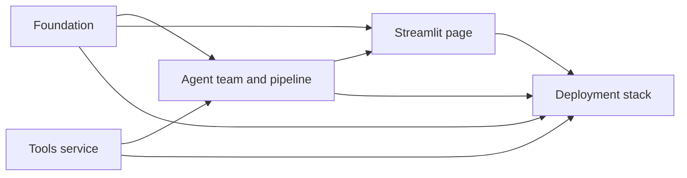

<!-- sarathi:artifact-format version="3" -->
# ResumeFit AI — Implementation Plan

## Implementation Approach

This plan builds the whole ResumeFit AI service described in `docs/spec.md` and
`docs/design.md` as five pull requests. The design already fixes every file
path, interface signature, data shape, and failure category, so the work can be
split along its natural component boundaries and handed to separate engineers
at the same time:

1. **Foundation** — guard functions, report models and scoring, usage limiter
   and access gate, settings and logging, shared outcome types, pinned
   application dependencies, and the local quality gate.
2. **Tools service** — the FastMCP server with text extraction, skill
   normalisation, PDF rendering, and its health route, in its own dependency
   set.
3. **Agent team and pipeline** — the six skill files, the AutoGen team, the MCP
   and OpenAI adapters, and the analysis pipeline that ties guards, limits,
   team, and report together.
4. **Streamlit page** — the user interface and its hardened configuration.
5. **Deployment** — Dockerfiles, Compose, Caddyfile, environment example, and
   README.

The PRs run in four executable waves. **Wave 1:** Foundation and tools service,
in parallel (no code dependency on each other). **Wave 2:** agent team and
pipeline. **Wave 3:** Streamlit page. **Wave 4:** deployment. Each later PR
branches from `master` only after its prerequisites are merged and the gate is
green there, so it builds on integrated code rather than on unmerged
contracts. Every file belongs to exactly one PR, with one deliberate
exception: the deployment PR adds a Docker job to the foundation-owned CI
workflow; waves are sequential, so the two edits never overlap.

Each behavioural PR is developed test-first: the first named test is written
and seen failing for the expected reason before the smallest implementation
is added. Configuration-only files (Dockerfiles, Compose, Caddyfile,
`.dockerignore` files) are checked by static tests written first; Docker is
not installed on the development machine, so image and Compose evidence comes
only from the CI Docker job and the VPS.

Plan Type: Implementation

The work is one coherent outcome — a deployable service — whose pieces share a
single approved design; no child needs its own requirements or design, so an
Implementation plan with a five-node PR graph is the right shape rather than a
Breakdown plan.

Stop and replan if the owner-run live OpenAI check shows the strict
structured-output schemas are rejected, if the cross-process MCP contract test
cannot pass with the pinned libraries, or if the first deployment shows
Streamlit cannot run on a read-only filesystem.

## Impact Map

| Area | What changes | Extent and consumers | PR |
| --- | --- | --- | --- |
| Repository tooling | Add `pyproject.toml`, `.pre-commit-config.yaml`, `.gitignore`, `.github/workflows/check.yml`, `scripts/check.py` | New; used by every later PR; later PRs must not edit these files, except that the deployment PR adds a Docker job to `check.yml` | Foundation (Docker job: Deployment) |
| Application dependencies | Add `app/requirements.txt`, `app/requirements-dev.txt` with the design's pinned set (including AutoGen, Streamlit, `mcp<2`) | New; consumed by agent-team, page, and deployment PRs, which must not edit them | Foundation |
| Application core modules | Add `app/resumefit/{__init__,config,observability,outcomes,schemas,report,limits}.py` and `app/resumefit/guardrails/*` | New; public functions are the design's interface contracts; consumed by pipeline and page | Foundation |
| Tools service | Add everything under `mcp_server/` except its Dockerfile and `.dockerignore` (including `resumefit_tools/worker.py`) | New, isolated package and dependency set; consumed over MCP only | Tools service |
| Agent layer and pipeline | Add `app/skills/*.md`, `app/resumefit/agents/*`, `app/resumefit/adapters/*`, `app/resumefit/pipeline.py` | New; consumes foundation contracts and the MCP tools contract; consumed by the page | Agent team |
| User interface | Add `app/streamlit_app.py`, `app/resumefit/ui.py`, `app/.streamlit/config.toml` | New; consumes pipeline, limits, report, config | Page |
| Deployment and docs | Add `app/Dockerfile`, `mcp_server/Dockerfile`, `app/.dockerignore`, `mcp_server/.dockerignore` (build contexts are `./app` and `./mcp_server`; no root `.dockerignore`), `docker-compose.yml`, `Caddyfile`, `.env.example`, `README.md`; add a Docker job to `.github/workflows/check.yml` | New; packages everything; operator-facing | Deployment |
| Tests | Add `app/tests/*` (split by owning PR as listed per PR) and `mcp_server/tests/*` | New; each test file owned by one PR | All |
| Data and schemas | No database or migrations; the report JSON schema "1.0" is introduced in Foundation | Published to visitors via downloads | Foundation |
| Observability | JSON log events and support IDs introduced in Foundation, emitted by the pipeline and page | Operator | Foundation, Agent team, Page |
| Deliberately untouched | `docs/*`, `.sdlc/*` process files (updated only by process stages); no FastAPI, database, or account code is added | — | — |

## Baseline Reuse

The repository is empty (greenfield; `git` initialised with no commits), and
there is no sibling system to reuse or extract from. Every PR is therefore new
behaviour. What is reused directly is third-party capability, not our code:
AutoGen's `SelectorGroupChat`, structured output, termination conditions, MCP
adapters, and replay test client; FastMCP's server, client, and health-route
support; Streamlit's widgets and `AppTest`; pypdf, python-docx, and fpdf2; and
Caddy's automatic HTTPS. The throwaway API spikes used to verify those
libraries were deleted and are not a baseline. Deferred: a shared-storage
limiter, a model-based injection classifier, and a script Content Security
Policy (see the design's risks).

## Overview

- **Goal:** a deployable ResumeFit AI service meeting every requirement in
  `docs/spec.md` through the technical model in `docs/design.md`.
- **Branch and CI context:** default branch `master` (no commits yet). One
  short-lived branch per PR (`pr/core-foundation`, `pr/mcp-tools`,
  `pr/agents-team`, `pr/ui-streamlit`, `pr/deploy-stack`). The local gate
  `python scripts/check.py` and its GitHub Actions mirror are introduced by the
  foundation PR; before that merges, the tools-service PR runs its commands
  directly. The deployment PR adds a CI Docker job (`docker compose config`
  and both image builds); CI and the VPS are the only places Docker runs.
- **Local environments:** `.venv` (application: `pip install -r
  app/requirements-dev.txt`) and `.venv-mcp` (tools service: `pip install -r
  mcp_server/requirements-dev.txt`), both Python 3.11. Both venvs were created
  and exercised while preparing the design.

Work Scope: product/system
Ready To Implement: Yes
Review Level: Standard
Extra Checks: security, privacy, external-integration

## Strategy

- **Delivery approach:** five cohesive PRs in four waves following the
  component boundaries: Wave 1 foundation and tools service in parallel
  (two implementers), then one PR per wave for the agent team, the page, and
  deployment, each started from `master` once its prerequisites are merged.
- **Test-first:** every PR names its first failing behavioural tests. Test
  names describe behaviour; no process identifiers appear in source, tests,
  comments, or logs.
- **Verification per PR:** focused tests for the PR, then the full gate once
  it exists (`python scripts/check.py`). Each PR records the exact commands and
  results in its description.
- **Extra checks:** security (upload, archive and parse-time limits,
  admission before parsing, forged-header resistance, smuggling, secrets,
  container CPU/memory and edge hardening), privacy (redaction, no
  persistence, log content), and external-integration (real FastMCP server
  in-process and cross-process; the OpenAI boundary by the official replay
  test double).
- **Merge-blocking evidence:** offline replay-based tests and the real MCP
  server exercised in-process (tools suite) and cross-process (contract
  test). The live OpenAI test is an optional owner-run pre-release check,
  skipped without `OPENAI_API_KEY`, and never blocks a merge.
- **Integration cadence:** after each merge the gate runs on `master` and must
  be green before the next wave branches; the cross-process contract test runs
  when the agent-team PR merges; the CI Docker job runs from the deployment PR
  onward; the first VPS deployment and smoke checklist follow the deployment
  PR with explicit owner approval.
- **Review depth:** Standard: one independent code review per PR, plus the
  staged `/code-assess` per PR. The deployment PR additionally gets a security
  review of Compose, Caddyfile, and Dockerfiles.
- **Cleanup and simplify:** each PR ends with a simplify pass on its own files
  (remove speculative options and unused helpers) before review.
- **Feedback cadence:** the owner reviews the running page locally after the
  page PR (UI review point), runs the optional live OpenAI check before
  release, and runs the VPS smoke checklist after the deployment PR.

## Milestones

<!-- sarathi:milestone id="MILE-CORE-READY" -->
- **Foundations ready.** Guardrails, report core, limits, config, quality gate,
  and the tools service are merged and green; both suites run from one command.

<!-- sarathi:milestone id="MILE-ANALYSIS-WORKING" -->
- **Analysis works end to end offline.** The agent team, pipeline, and page are
  merged; the page completes an analysis with replayed model responses, and
  the application talks to the real tools service across processes.

<!-- sarathi:milestone id="MILE-SERVICE-DEPLOYABLE" -->
- **Service deployable.** Deployment files and README are merged and statically
  verified; the owner can deploy and run the smoke checklist.

## Pull Requests

### Foundation: guardrails, report core, limits, config, and quality gate
<!-- sarathi:pr id="PR-CORE-FOUNDATION" milestone="MILE-CORE-READY" -->

- **Outcome:** every deterministic rule the product relies on exists as a
  tested, importable function: upload and text guards, smuggling catalogue,
  redaction, moderation adapter, usage limiter and access gate, report models,
  scoring, sanitisation and Markdown/JSON rendering, settings, logging,
  support IDs, visitor keys, and the shared outcome types. The one-command
  gate, pre-commit hook, and CI mirror exist.
- **Files (exclusive scope):** `pyproject.toml`, `.pre-commit-config.yaml`,
  `.gitignore` (must list `.env`, `.venv*`, caches), `.github/workflows/check.yml`,
  `scripts/check.py`, `app/requirements.txt`, `app/requirements-dev.txt`,
  `app/resumefit/__init__.py`, `app/resumefit/config.py`,
  `app/resumefit/observability.py`, `app/resumefit/outcomes.py`,
  `app/resumefit/schemas.py`, `app/resumefit/report.py`,
  `app/resumefit/limits.py`, `app/resumefit/guardrails/__init__.py`,
  `app/resumefit/guardrails/uploads.py`, `app/resumefit/guardrails/text_checks.py`,
  `app/resumefit/guardrails/injection_patterns.txt`,
  `app/resumefit/guardrails/pii.py`, `app/resumefit/guardrails/moderation.py`,
  `app/tests/conftest.py`, `app/tests/fixtures/` (sample resumes and job
  descriptions as text, `smuggling_samples.txt`, `legitimate_samples/`),
  `app/tests/test_uploads.py`, `app/tests/test_text_checks.py`,
  `app/tests/test_pii.py`, `app/tests/test_moderation.py`,
  `app/tests/test_limits.py`, `app/tests/test_admission.py`,
  `app/tests/test_identity.py`, `app/tests/test_report.py`,
  `app/tests/test_config.py`, `app/tests/test_observability.py`.
- **Impact:** new application core and tooling; defines the contracts other
  PRs import (`outcomes`, `schemas`, `limits`, `config`, `observability`,
  `guardrails`, `report`). `pyproject.toml` registers the `live` pytest marker
  and sets `asyncio_mode = "auto"` and `pythonpath` for both packages.
- **Assigned intent:** COMP-GUARDRAILS, COMP-LIMITS, COMP-REPORT, COMP-CONFIG;
  TEST-GUARD-UPLOAD, TEST-GUARD-TEXT, TEST-GUARD-PII, TEST-GUARD-MODERATION,
  TEST-LIMITS-POLICY, TEST-LIMITS-ADMISSION, TEST-IDENTITY-FORGED,
  TEST-REPORT-FINALIZE, TEST-CONFIG-LOGGING;
  FR-UPLOAD-TYPES, FR-UPLOAD-SIGNATURE, FR-UPLOAD-SIZE, FR-UPLOAD-TEXTLEN,
  FR-INPUT-JDLEN, FR-GUARD-INJECTION, FR-GUARD-RESUMESHAPE, FR-GUARD-JDSHAPE,
  FR-GUARD-MODERATION, FR-GUARD-FAILCLOSED, FR-PRIVACY-REDACT,
  FR-ANALYSIS-PROFILE, FR-ANALYSIS-REQUIREMENTS, FR-ANALYSIS-RUBRIC,
  FR-ANALYSIS-SCORE, FR-COACH-BULLETS, FR-COACH-QUESTIONS, FR-COACH-LEARNING,
  FR-REPORT-JSON, FR-REPORT-MARKDOWN, FR-REPORT-SAFETEXT, FR-COST-ADMISSION,
  FR-COST-DAILY, FR-COST-CONCURRENT, FR-COST-BUSY, FR-COST-BUDGET,
  FR-COST-IDENTITY (app side), FR-ACCESS-CODE,
  FR-ACCESS-LOCKOUT, FR-OPS-LOGS, FR-ERROR-SAFE; NFR-GUARD-ACCURACY,
  NFR-PRIVACY-LOGS, NFR-SEC-SECRETS; AT-UPLOAD-TYPES, AT-UPLOAD-SIGNATURE,
  AT-UPLOAD-SIZE, AT-UPLOAD-TEXTLEN, AT-INPUT-JDLEN, AT-GUARD-INJECTION,
  AT-GUARD-RESUMESHAPE, AT-GUARD-JDSHAPE, AT-GUARD-MODERATION,
  AT-GUARD-FAILCLOSED, AT-PRIVACY-REDACT, AT-ANALYSIS-PROFILE,
  AT-ANALYSIS-REQUIREMENTS, AT-ANALYSIS-RUBRIC, AT-ANALYSIS-SCORE,
  AT-COACH-BULLETS, AT-COACH-QUESTIONS, AT-COACH-LEARNING, AT-REPORT-JSON,
  AT-REPORT-MARKDOWN, AT-REPORT-SAFETEXT, AT-COST-DAILY, AT-COST-CONCURRENT,
  AT-COST-BUSY, AT-COST-BUDGET, AT-COST-ADMISSION (limiter part),
  AT-COST-FLOOD, AT-COST-FORGEDHEADERS (app part), AT-ACCESS-LOCKOUT,
  AT-OPS-LOGS; JT-COST-QUOTA
  (limiter part); UC-ACCESS-UNLOCK and UC-OPS-DIAGNOSE (core rules).
- **First failing tests (red):** `test_zip_renamed_to_pdf_is_rejected_as_mismatch`,
  `test_smuggling_corpus_is_fully_rejected_and_legitimate_corpus_passes`,
  `test_email_phone_url_and_address_become_placeholders`,
  `test_three_of_four_must_haves_award_thirty_of_forty`,
  `test_sixth_start_on_same_utc_day_is_refused_until_midnight`,
  `test_flood_admits_at_most_one_per_visitor_and_three_overall`,
  `test_released_admission_without_start_keeps_quota`,
  `test_forged_forwarded_for_does_not_change_visitor_key`,
  `test_locked_out_visitor_stays_locked_with_forged_headers`,
  `test_log_event_rejects_free_text_fields`. Each fails first with an import
  error, then with the assertion once a stub exists.
- **Smallest green implementation:** plain functions and dataclasses exactly as
  in the design's interface section; the catalogue as a text file of regular
  expressions; no framework.
- **Refactor:** extract shared normalisation (NFKC, zero-width removal) used by
  smuggling and length checks; keep functions pure.
- **Test levels and fixtures:** unit tests only; moderation uses an injected
  fake API client (drift covered later by the live real-dependency test);
  threads plus a controllable clock for the limiter.
- **Verification (pass/fail):** `.\.venv\Scripts\python -m pytest app/tests -q`
  green; `.\.venv\Scripts\python -m pytest app/tests/test_admission.py
  app/tests/test_identity.py -q` green (admission flood and forged headers);
  `python scripts/check.py` green (runs lint, format, mypy, and whichever
  suites exist); `pre-commit run --all-files` green.
- **Extra risk work:** security (smuggling corpus, secrets masking, admission
  flood, forged headers), privacy (redaction, log allow-list).
- **Feedback:** demonstrates that the rules match the spec's numbers; judged by
  the reviewer against the spec tables; the plan changes if any threshold in
  the spec proves unworkable on the corpus (for example legitimate resumes
  flagged).
- **Dependencies:** none. Wave 1, in parallel with the tools-service PR.
- **Rollback:** revert the PR; nothing else depends on it until later merges.
- **Why cohesive:** all pure rule code plus the tooling that checks it; one
  reviewer can compare it against the spec in one sitting.
- Work Classification: new behavior

### Tools service: FastMCP server and tools
<!-- sarathi:pr id="PR-MCP-TOOLS" milestone="MILE-CORE-READY" -->

- **Outcome:** a runnable FastMCP 4 server exposing `extract_resume_text`,
  `normalize_skills`, `render_pdf`, and `GET /health` exactly as in the design's
  tools contract, with hostile-file protections.
- **Files (exclusive scope):** `mcp_server/requirements.txt`,
  `mcp_server/requirements-dev.txt`, `mcp_server/resumefit_tools/__init__.py`,
  `mcp_server/resumefit_tools/server.py`, `mcp_server/resumefit_tools/extraction.py`,
  `mcp_server/resumefit_tools/taxonomy.py`, `mcp_server/resumefit_tools/taxonomy.json`,
  `mcp_server/resumefit_tools/pdf_render.py`, `mcp_server/resumefit_tools/worker.py`,
  `mcp_server/tests/conftest.py`,
  `mcp_server/tests/test_extraction.py`, `mcp_server/tests/test_worker.py`,
  `mcp_server/tests/slow_targets.py` (importable never-returning target for
  the worker tests), `mcp_server/tests/test_taxonomy.py`,
  `mcp_server/tests/test_pdf_render.py`, `mcp_server/tests/test_server.py`.
- **Impact:** new isolated package with its own pinned dependency set
  (`fastmcp==4.0.10`, `pypdf==6.19.0`, `python-docx==1.2.0`, `fpdf2==2.8.9`);
  consumed only over MCP by the agent-team PR and packaged by the deployment PR.
- **Assigned intent:** COMP-MCPSERVER; TEST-MCP-EXTRACT, TEST-MCP-ISOLATION,
  TEST-MCP-NORMALIZE, TEST-MCP-PDF, TEST-MCP-SERVER; FR-UPLOAD-PAGES,
  FR-UPLOAD-ARCHIVE, FR-UPLOAD-PARSETIME, FR-UPLOAD-TYPES,
  FR-UPLOAD-SIGNATURE, FR-UPLOAD-SIZE, FR-ANALYSIS-SKILLS, FR-REPORT-PDF,
  FR-OPS-HEALTH; NFR-ARCH-MCP, NFR-CAP-RESOURCES (extraction slot cap);
  AT-UPLOAD-PAGES, AT-UPLOAD-ARCHIVE, AT-UPLOAD-PARSETIME, AT-UPLOAD-TEXTLEN
  (image-only PDF yields empty text), AT-ANALYSIS-SKILLS (normalisation part),
  AT-REPORT-PDF, AT-OPS-HEALTH (tools-service part).
- **First failing tests (red):** `test_six_page_pdf_is_rejected_as_too_many_pages`,
  `test_docx_expanding_beyond_limit_is_rejected`,
  `test_docx_with_encrypted_or_nested_entry_is_rejected_as_unsafe`,
  `test_slow_extraction_times_out_and_worker_is_killed`,
  `test_health_answers_while_extraction_hangs`,
  `test_at_most_two_extractions_run_at_once`, `test_js_normalizes_to_javascript`,
  `test_rendered_pdf_contains_every_section_heading`,
  `test_server_lists_exactly_three_tools`, `test_foreign_host_header_is_rejected`.
- **Smallest green implementation:** module functions in `extraction.py`,
  `taxonomy.py`, `pdf_render.py`; `worker.py` runs the extraction function in a
  `spawn`ed child process behind a semaphore of 2 and kills it at the
  deadline; thin `@mcp.tool` wrappers in `server.py`
  that decode base64 and return the documented dictionaries; `main()` calls
  `mcp.run(transport="http", host="0.0.0.0", port=8000, stateless_http=True,
  allowed_hosts=...)`.
- **Refactor:** share the error-result helper; keep taxonomy loading cached.
- **Test levels and fixtures:** unit tests on the pure modules; integration
  tests against the real FastMCP server in-process via `fastmcp.Client(mcp)`
  and Starlette `TestClient(mcp.http_app())`; binary fixtures generated at
  test time in `conftest.py` (no binary files committed). Confirm and document
  in a test the exact `allowed_hosts` value format that accepts `mcp:8000`.
- **Verification (pass/fail):** `.\.venv-mcp\Scripts\python -m pytest
  mcp_server/tests -q` green; `.\.venv-mcp\Scripts\python -m pytest
  mcp_server/tests/test_worker.py -q` green (hostile/slow file times out,
  `/health` stays 200, cap of 2 holds); a manual `python -m resumefit_tools.server` start
  answers `curl http://127.0.0.1:8000/health` with `{"status":"ok"}`.
- **Extra risk work:** security (decompression, entry-count, encryption,
  nesting, and page caps; killable worker with deadline; encrypted and corrupt
  files; no secrets in the package; content-free logging).
- **Feedback:** demonstrates the tools contract the application will rely on;
  judged by the tests and by the agent-team PR's contract test; the plan
  changes if the Host protection cannot accept the internal hostname (then the
  design's allowed-hosts decision is revised).
- **Dependencies:** none. Wave 1, in parallel with PR-CORE-FOUNDATION. If it
  merges before the foundation PR, lint with default Ruff settings.
- **Rollback:** revert; the application is unaffected until the agent-team PR.
- **Why cohesive:** one deployable service with one contract, reviewable on its
  own.
- Work Classification: new behavior

### Agent team, adapters, and analysis pipeline
<!-- sarathi:pr id="PR-AGENTS-TEAM" milestone="MILE-ANALYSIS-WORKING" -->

- **Outcome:** `resumefit.pipeline.run_analysis` and `analyse` perform a
  complete analysis: early admission, guards, extraction via the tools
  service, redaction, moderation, quota consumption at team start, the
  six-agent AutoGen team with skill files and the `normalize_skills` MCP tool,
  one aggregated token budget, the single report retry, scoring, Markdown,
  JSON, PDF, pipeline timeline events for every stage and tool call, failure
  categories, one log event per attempt, and guaranteed cleanup of the model
  client and MCP sessions.
- **Files (exclusive scope):** `app/skills/orchestrator.md`,
  `app/skills/resume_parser.md`, `app/skills/jd_analyst.md`,
  `app/skills/matcher.md`, `app/skills/coach.md`, `app/skills/report_writer.md`,
  `app/resumefit/agents/__init__.py`, `app/resumefit/agents/skills.py`,
  `app/resumefit/agents/team.py`, `app/resumefit/agents/timeline.py`,
  `app/resumefit/adapters/__init__.py`, `app/resumefit/adapters/tools_gateway.py`,
  `app/resumefit/adapters/models.py`, `app/resumefit/pipeline.py`,
  `app/tests/pipeline_fakes.py` (in-memory tools gateway, fake moderator,
  replay scripts), `app/tests/test_skills.py`, `app/tests/test_team.py`,
  `app/tests/test_timeline.py`, `app/tests/test_pipeline.py`,
  `app/tests/test_pipeline_lifecycle.py`,
  `app/tests/test_mcp_contract.py`, `app/tests/test_live_openai.py`,
  `app/tests/fixtures/redteam_samples.txt`.
- **Impact:** new agent layer and orchestration shell; consumes the foundation
  contracts unchanged and the tools contract; exposes the pipeline entry point
  the page calls. Must not edit foundation files; if a contract gap appears,
  stop and agree a follow-up change to the foundation files with their author.
- **Assigned intent:** COMP-TEAM, COMP-ADAPTERS, COMP-PIPELINE;
  TEST-TEAM-REPLAY, TEST-MCP-CONTRACT, TEST-PIPELINE-FLOW,
  TEST-PIPELINE-CLEANUP, TEST-LIVE-OPENAI (optional, owner-run);
  FR-AGENTS-ROLES, FR-PROGRESS-TIMELINE (event mapping and pipeline events),
  FR-ANALYSIS-SKILLS (tool path), FR-COST-STOP, FR-COST-ADMISSION (stage
  order), FR-GUARD-NOSPEND, FR-REPORT-RETRY, FR-UPLOAD-PARSETIME (error-code
  mapping),
  FR-REPORT-PDFFALLBACK, FR-PRIVACY-NOSTORE, FR-PRIVACY-REDACT (end to end),
  FR-ERROR-SAFE (category mapping), FR-OPS-LOGS (emission), FR-UPLOAD-PAGES and
  FR-REPORT-PDF (through the gateway); NFR-ARCH-AGENTS, NFR-ARCH-MCP,
  NFR-PERF-DURATION, NFR-PERF-FEEDBACK, NFR-COST-TOKENS, NFR-SEC-INJECTION,
  NFR-PRIVACY-LOGS; AT-AGENTS-ROLES, AT-COST-STOP, AT-COST-ADMISSION (pipeline
  part), AT-PROGRESS-TIMELINE,
  AT-GUARD-NOSPEND, AT-GUARD-FAILCLOSED (pipeline part), AT-REPORT-RETRY,
  AT-ERROR-SAFE, AT-REPORT-PDFFALLBACK, AT-PRIVACY-NOSTORE, AT-PRIVACY-REDACT,
  AT-OPS-LOGS, AT-ARCH-MCP, AT-ANALYSIS-SKILLS, AT-PERF-DURATION,
  AT-SEC-INJECTIONLIVE; JT-GUARD-HOSTILE, JT-COST-QUOTA; UC-ANALYSIS-RUN.
- **First failing tests (red):**
  `test_orchestrator_delegates_in_order_and_report_writer_ends_run`,
  `test_unknown_next_agent_falls_back_to_next_missing_specialist`,
  `test_timeline_hides_task_message_and_summarises_tool_calls`,
  `test_refused_admission_makes_no_extraction_or_moderation_call`,
  `test_first_timeline_entry_precedes_extraction`,
  `test_rejected_input_makes_no_model_call_and_keeps_quota`,
  `test_invalid_report_is_retried_once_then_fails`,
  `test_retry_is_skipped_when_token_budget_is_insufficient`,
  `test_model_client_and_gateway_closed_on_timeout_and_cancellation`,
  `test_gateway_extracts_pdf_text_from_real_tools_service`.
- **Smallest green implementation:** skill files with the five required
  headings; `build_team` and `select_next_speaker` as specified (including
  `custom_message_types`); `ToolsGateway` as an async context manager over one
  `McpWorkbench` and one `create_mcp_server_session` with a filtered
  `mcp_server_tools` list; `run_analysis` as a straight sequence of stages
  inside one `AsyncExitStack` with one `try/except/finally`.
- **Refactor:** move repeated event-summary formatting into `timeline.py`;
  keep the pipeline a single readable function plus small helpers.
- **Test levels and fixtures:** component tests with AutoGen's official
  `ReplayChatCompletionClient` (per-agent scripts, `CreateResult` for tool
  calls and usage); pipeline tests with the in-memory gateway and fake
  moderator; the cross-process real-boundary contract test starts the real
  tools service from `.venv-mcp` (interpreter from `RESUMEFIT_MCP_PYTHON`) and
  must run, not skip, before merge; the live real-dependency test
  (`-m live`, `OPENAI_API_KEY` set) is an optional owner-run pre-release check
  (1 run, then `RESUMEFIT_LIVE_RUNS=10` with the red-team set); it is skipped
  without a key and does not block the merge.
- **Verification (pass/fail), merge-blocking:** `.\.venv\Scripts\python -m
  pytest app/tests -q` green with the contract test executed (not skipped);
  `.\.venv\Scripts\python -m pytest app/tests/test_pipeline.py
  app/tests/test_pipeline_lifecycle.py -q` green (admission ordering, timeline
  events, token budget, cleanup on success, timeout, and cancellation);
  `python scripts/check.py` green. **Not merge-blocking:** `.\.venv\Scripts\python
  -m pytest app/tests -m live -q` run by the owner before release with a real
  key (record duration and tokens); without a key it is recorded as
  unavailable, not passing.
- **Extra risk work:** external integration (replay double drift recorded as a
  risk; contract test, optional live check), security (data markers and skill
  rules, agents limited to `normalize_skills`), privacy (recorded model inputs
  free of contact details), cost (termination limits, aggregated token
  budget, per-call output cap), reliability (client and session cleanup).
- **Feedback:** demonstrates that the orchestrated team produces a valid,
  scored report within limits; judged by the replay tests and the contract
  test, and later by the owner's live run; the plan changes if OpenAI rejects
  the schemas, if typical token use exceeds the spec's median, or if the
  orchestrator frequently needs the fallback path.
- **Dependencies:** Wave 2. Branches from `master` after PR-CORE-FOUNDATION
  (imports its contracts) and PR-MCP-TOOLS (contract test needs the server)
  are both merged and the gate is green.
- **Rollback:** revert; the page PR is not yet merged, so nothing else breaks.
- **Why cohesive:** the team, its adapters, and the pipeline that runs it form
  one runtime path that is only testable together.
- Work Classification: new behavior

### Streamlit page and configuration
<!-- sarathi:pr id="PR-UI-STREAMLIT" milestone="MILE-ANALYSIS-WORKING" -->

- **Outcome:** the public page: privacy notice, optional access code, upload
  and job-description inputs, quota counter, live timeline, run status, report
  sections, three downloads with PDF fallback note, error messages with support
  ID, and **Start over**; plus the hardened Streamlit configuration.
- **Files (exclusive scope):** `app/streamlit_app.py`, `app/resumefit/ui.py`,
  `app/.streamlit/config.toml`, `app/tests/test_ui.py`.
- **Impact:** new presentation layer; consumes `pipeline.analyse`,
  `limits.AccessGate`, `limits.UsageLimiter.remaining`, `report` rendering
  helpers, `observability.client_identity` and `visitor_key` (one key for
  both the limiter and the access gate), and `outcomes`.
- **Assigned intent:** COMP-UI; TEST-UI-APPTEST; FR-PRIVACY-NOTICE,
  FR-PRIVACY-CLEAR, FR-PROGRESS-TIMELINE (display), FR-PROGRESS-STATUS,
  FR-REPORT-DISPLAY, FR-REPORT-JSON, FR-REPORT-MARKDOWN, FR-REPORT-PDF (download
  buttons), FR-REPORT-PDFFALLBACK (note), FR-ACCESS-CODE, FR-ERROR-SAFE
  (display); NFR-A11Y-FORMS, NFR-SEC-BROWSER (config file); AT-PRIVACY-NOTICE,
  AT-PRIVACY-CLEAR, AT-PROGRESS-STATUS, AT-PROGRESS-TIMELINE, AT-REPORT-DISPLAY,
  AT-REPORT-JSON, AT-REPORT-MARKDOWN, AT-REPORT-PDF, AT-REPORT-PDFFALLBACK,
  AT-ERROR-SAFE, AT-ACCESS-CODE, AT-ACCESS-LOCKOUT (message), AT-A11Y-FORMS;
  JT-ANALYSIS-FIRSTUSE; UC-REPORT-DOWNLOAD, UC-ACCESS-UNLOCK, UC-ANALYSIS-RUN.
- **First failing tests (red):** `test_privacy_notice_appears_before_uploader`,
  `test_gated_page_shows_only_code_prompt_until_correct_code`,
  `test_completed_analysis_shows_score_sections_and_three_downloads`,
  `test_crashing_analysis_shows_generic_message_without_exception_text`,
  `test_start_over_clears_report_and_timeline`.
- **Smallest green implementation:** a single-column script with an `on_click`
  callback for **Analyse**, `asyncio.run(pipeline.analyse(...))` inside the
  handler, `st.status` for the timeline, and helpers in `ui.py` for escaping
  and section rendering.
- **Refactor:** keep `streamlit_app.py` as layout only; move formatting into
  `ui.py`.
- **Test levels and fixtures:** Streamlit's official `AppTest.from_file` with
  `resumefit.pipeline.analyse` monkeypatched to a fake that emits timeline
  entries and returns fixture outcomes built with foundation models; uploads
  via `file_uploader[0].set_value`.
- **Verification (pass/fail):** `.\.venv\Scripts\python -m pytest
  app/tests/test_ui.py -q` green; `python scripts/check.py` green; manual local
  run (`streamlit run app/streamlit_app.py` with the tools service running and
  a real key, or with the replay fake) reviewed by the owner.
- **Extra risk work:** security (no unsafe HTML, escaped report text, error
  details hidden, XSRF and CORS protection on, usage statistics off, 2 MB
  upload cap), accessibility (labels, text score, keyboard walk-through).
- **UI stakeholder review point:** after merge the owner reviews the running
  page (no prototype exists; `UI Mock Preference: Not needed`). Feedback
  status is recorded in `.sdlc/wip.md`; requested layout changes are small
  follow-ups within `app/resumefit/ui.py` and `app/streamlit_app.py`.
- **Feedback:** demonstrates the visitor journey; judged by the owner in a
  browser; the plan changes if the timeline or report layout is unreadable on
  a phone-width window.
- **Dependencies:** Wave 3. Branches from `master` after PR-AGENTS-TEAM is
  merged (and therefore PR-CORE-FOUNDATION), so the page is built and
  reviewed against the integrated pipeline; tests still replace `analyse`.
- **Rollback:** revert; the pipeline remains usable from tests.
- **Why cohesive:** one page and its configuration, reviewable visually and by
  one AppTest suite.
- Work Classification: new behavior

### Deployment stack and README
<!-- sarathi:pr id="PR-DEPLOY-STACK" milestone="MILE-SERVICE-DEPLOYABLE" -->

- **Outcome:** the owner can deploy the service to a VPS with one command
  behind automatic HTTPS, and knows how to verify, operate, and troubleshoot
  it.
- **Files (exclusive scope):** `app/Dockerfile`, `mcp_server/Dockerfile`,
  `app/.dockerignore`, `mcp_server/.dockerignore`, `docker-compose.yml`,
  `Caddyfile`, `.env.example`, `README.md`,
  `app/tests/test_deployment_files.py`, `app/tests/test_dockerignore.py`;
  plus one agreed edit to the foundation-owned `.github/workflows/check.yml`
  (a new `docker` job: `cp .env.example .env`, `docker compose config -q`,
  `docker compose build app mcp`, and the non-root/no-`.env` image probe).
- **Impact:** new operational surface; packages both services using their
  requirements files and entry points; documents every setting in the design's
  settings contract, including the owner-accepted limit defaults; extends CI
  with the only Docker execution available before the VPS.
- **Assigned intent:** COMP-EDGE; TEST-DEPLOY-STATIC, TEST-DEPLOY-IMAGES,
  TEST-DEPLOY-SMOKE, TEST-SUITE-OFFLINE; FR-COST-IDENTITY (Caddy header
  overwrite); NFR-SEC-TRANSPORT, NFR-SEC-EXPOSURE, NFR-SEC-CONTAINERS,
  NFR-SEC-BROWSER, NFR-SEC-SECRETS, NFR-REL-RECOVERY, NFR-CAP-CONCURRENCY,
  NFR-CAP-RESOURCES (compose `cpus` and memory),
  NFR-DEPLOY-COMPOSE, NFR-DOCS-README, NFR-PRIVACY-THIRDPARTY, NFR-ARCH-SIMPLE,
  NFR-TEST-OFFLINE; FR-OPS-HEALTH (container health checks); AT-SEC-CONFIG,
  AT-SEC-EDGE, AT-DEPLOY-COMPOSE, AT-OPS-HEALTH, AT-OPS-RECOVERY,
  AT-PRIVACY-THIRDPARTY, AT-A11Y-FORMS (keyboard walk-through),
  AT-COST-FORGEDHEADERS (proxy part), AT-TEST-OFFLINE; JT-OPS-GOLIVE;
  UC-OPS-DEPLOY, UC-OPS-DIAGNOSE.
- **First failing tests (red):** `test_only_caddy_publishes_ports_80_and_443`,
  `test_tools_service_is_only_on_internal_network`,
  `test_app_and_mcp_have_cpu_and_memory_limits`,
  `test_both_images_run_as_non_root_user`,
  `test_each_build_context_dockerignore_excludes_env_venv_and_tests`,
  `test_env_example_keys_match_settings_contract`,
  `test_caddyfile_sets_every_security_header`,
  `test_caddyfile_overwrites_client_ip_headers`,
  `test_readme_has_deploy_security_and_limitations_sections`. These are
  configuration checks written before the files, per the test-first exception
  for deployment configuration.
- **Smallest green implementation:** the files exactly as described in the
  design's edge component; README sections: overview, architecture, local run
  (two venvs), tests and gate, configuration table, deployment, smoke
  checklist, security and privacy, limitations, logs, report schema.
- **Refactor:** remove any Compose option not required by the design.
- **Test levels and fixtures:** static tests with PyYAML and `tomllib`; the
  offline-suite budget check (`python scripts/check.py` timed, with
  `OPENAI_API_KEY` unset). Docker is not installed locally, so `docker compose
  config` and both image builds run only in the CI Docker job (and later on
  the VPS) — say so in the PR description and link the CI run as evidence.
  The post-deploy smoke checklist runs on the VPS only after explicit owner
  approval.
- **Verification (pass/fail):** `.\.venv\Scripts\python -m pytest
  app/tests/test_deployment_files.py app/tests/test_dockerignore.py -q` green;
  `python scripts/check.py` green in under 5 minutes; the PR's CI `docker` job
  green (`docker compose config -q` exits 0, both images build, probe shows a
  non-zero UID and no `.env`); independent security review of the config
  files; after owner-approved deployment, every smoke item recorded.
- **Extra risk work:** build and deployment (CI Docker job), security (edge
  headers, client-IP header overwrite, network isolation, least privilege,
  CPU/memory limits, secrets), privacy (no analytics), docs.
- **Feedback:** demonstrates a deployable service; judged by the owner's first
  deployment and the smoke checklist; the plan changes if Streamlit fails on a
  read-only root, the websocket fails through Caddy, or the tools service
  rejects the internal Host header (each has a named fallback in the design's
  risks).
- **Dependencies:** Wave 4. Branches from `master` after PR-CORE-FOUNDATION,
  PR-MCP-TOOLS, PR-AGENTS-TEAM, and PR-UI-STREAMLIT are merged (packages their
  entry points, reads the Streamlit config in its static test, and edits the
  CI workflow).
- **Rollback:** revert the PR; on the VPS, `git checkout` the previous commit
  and `docker compose up -d --build`; there is no data to migrate.
- **Why cohesive:** all deployment configuration and its documentation change
  together and are reviewed together by one operator-minded reviewer.
- Work Classification: new behavior

## Coverage Map

Every requirement, acceptance scenario, journey, component, and design test
obligation is assigned below. "Manual" means non-code verification with a
recorded result; "live" means the optional owner-run real-OpenAI test, which
is never merge-blocking.

### Use cases

| Use case | PRs | Evidence |
| --- | --- | --- |
| UC-ANALYSIS-RUN | PR-AGENTS-TEAM, PR-UI-STREAMLIT | Pipeline flow tests, AppTest journey |
| UC-REPORT-DOWNLOAD | PR-CORE-FOUNDATION, PR-UI-STREAMLIT | Report rendering tests, AppTest downloads |
| UC-ACCESS-UNLOCK | PR-CORE-FOUNDATION, PR-UI-STREAMLIT | Access-gate unit tests, AppTest gate |
| UC-OPS-DEPLOY | PR-DEPLOY-STACK | Static deployment tests, manual smoke checklist |
| UC-OPS-DIAGNOSE | PR-CORE-FOUNDATION, PR-AGENTS-TEAM, PR-DEPLOY-STACK | Log tests, pipeline log assertions, README |

### Functional requirements

| Requirements | PRs | Test obligations |
| --- | --- | --- |
| FR-UPLOAD-TYPES, FR-UPLOAD-SIGNATURE, FR-UPLOAD-SIZE | PR-CORE-FOUNDATION, PR-MCP-TOOLS | TEST-GUARD-UPLOAD, TEST-MCP-EXTRACT |
| FR-UPLOAD-PAGES | PR-MCP-TOOLS, PR-AGENTS-TEAM | TEST-MCP-EXTRACT, TEST-MCP-CONTRACT |
| FR-UPLOAD-ARCHIVE | PR-MCP-TOOLS | TEST-MCP-EXTRACT |
| FR-UPLOAD-PARSETIME | PR-MCP-TOOLS, PR-AGENTS-TEAM | TEST-MCP-ISOLATION, TEST-PIPELINE-FLOW |
| FR-UPLOAD-TEXTLEN, FR-INPUT-JDLEN | PR-CORE-FOUNDATION | TEST-GUARD-UPLOAD |
| FR-GUARD-INJECTION, FR-GUARD-RESUMESHAPE, FR-GUARD-JDSHAPE | PR-CORE-FOUNDATION | TEST-GUARD-TEXT |
| FR-GUARD-MODERATION, FR-GUARD-FAILCLOSED | PR-CORE-FOUNDATION, PR-AGENTS-TEAM | TEST-GUARD-MODERATION, TEST-PIPELINE-FLOW |
| FR-GUARD-NOSPEND | PR-AGENTS-TEAM | TEST-PIPELINE-FLOW |
| FR-PRIVACY-REDACT | PR-CORE-FOUNDATION, PR-AGENTS-TEAM | TEST-GUARD-PII, TEST-PIPELINE-FLOW |
| FR-PRIVACY-NOSTORE | PR-AGENTS-TEAM | TEST-PIPELINE-FLOW |
| FR-PRIVACY-NOTICE, FR-PRIVACY-CLEAR | PR-UI-STREAMLIT | TEST-UI-APPTEST |
| FR-ANALYSIS-PROFILE, FR-ANALYSIS-REQUIREMENTS, FR-ANALYSIS-RUBRIC, FR-ANALYSIS-SCORE | PR-CORE-FOUNDATION | TEST-REPORT-FINALIZE |
| FR-ANALYSIS-SKILLS | PR-MCP-TOOLS, PR-AGENTS-TEAM | TEST-MCP-NORMALIZE, TEST-TEAM-REPLAY, TEST-LIVE-OPENAI |
| FR-AGENTS-ROLES | PR-AGENTS-TEAM | TEST-TEAM-REPLAY |
| FR-COACH-BULLETS, FR-COACH-QUESTIONS, FR-COACH-LEARNING | PR-CORE-FOUNDATION | TEST-REPORT-FINALIZE |
| FR-PROGRESS-TIMELINE | PR-AGENTS-TEAM, PR-UI-STREAMLIT | TEST-TEAM-REPLAY, TEST-PIPELINE-FLOW, TEST-UI-APPTEST |
| FR-PROGRESS-STATUS, FR-REPORT-DISPLAY | PR-UI-STREAMLIT | TEST-UI-APPTEST |
| FR-REPORT-JSON, FR-REPORT-MARKDOWN | PR-CORE-FOUNDATION, PR-UI-STREAMLIT | TEST-REPORT-FINALIZE, TEST-UI-APPTEST |
| FR-REPORT-PDF | PR-MCP-TOOLS, PR-AGENTS-TEAM, PR-UI-STREAMLIT | TEST-MCP-PDF, TEST-MCP-CONTRACT, TEST-UI-APPTEST |
| FR-REPORT-PDFFALLBACK | PR-AGENTS-TEAM, PR-UI-STREAMLIT | TEST-PIPELINE-FLOW, TEST-UI-APPTEST |
| FR-REPORT-SAFETEXT | PR-CORE-FOUNDATION | TEST-REPORT-FINALIZE |
| FR-REPORT-RETRY | PR-AGENTS-TEAM | TEST-PIPELINE-FLOW |
| FR-ERROR-SAFE | PR-CORE-FOUNDATION, PR-AGENTS-TEAM, PR-UI-STREAMLIT | TEST-CONFIG-LOGGING, TEST-PIPELINE-FLOW, TEST-PIPELINE-CLEANUP, TEST-UI-APPTEST |
| FR-COST-ADMISSION | PR-CORE-FOUNDATION, PR-AGENTS-TEAM | TEST-LIMITS-ADMISSION, TEST-PIPELINE-FLOW |
| FR-COST-DAILY, FR-COST-BUDGET | PR-CORE-FOUNDATION | TEST-LIMITS-POLICY |
| FR-COST-CONCURRENT, FR-COST-BUSY | PR-CORE-FOUNDATION | TEST-LIMITS-POLICY, TEST-LIMITS-ADMISSION |
| FR-COST-STOP | PR-AGENTS-TEAM | TEST-TEAM-REPLAY, TEST-PIPELINE-FLOW, TEST-PIPELINE-CLEANUP |
| FR-COST-IDENTITY | PR-CORE-FOUNDATION, PR-DEPLOY-STACK | TEST-IDENTITY-FORGED, TEST-DEPLOY-STATIC, TEST-DEPLOY-SMOKE |
| FR-ACCESS-CODE | PR-CORE-FOUNDATION, PR-UI-STREAMLIT | TEST-LIMITS-POLICY, TEST-UI-APPTEST |
| FR-ACCESS-LOCKOUT | PR-CORE-FOUNDATION | TEST-LIMITS-POLICY |
| FR-OPS-HEALTH | PR-MCP-TOOLS, PR-DEPLOY-STACK | TEST-MCP-SERVER, TEST-DEPLOY-STATIC, TEST-DEPLOY-SMOKE |
| FR-OPS-LOGS | PR-CORE-FOUNDATION, PR-AGENTS-TEAM | TEST-CONFIG-LOGGING, TEST-PIPELINE-FLOW |

### Supplementary requirements

| Requirements | PRs | Evidence |
| --- | --- | --- |
| NFR-PERF-DURATION, NFR-PERF-FEEDBACK, NFR-COST-TOKENS, NFR-SEC-INJECTION | PR-AGENTS-TEAM | TEST-LIVE-OPENAI (live, before release) |
| NFR-GUARD-ACCURACY | PR-CORE-FOUNDATION | TEST-GUARD-TEXT |
| NFR-PRIVACY-LOGS | PR-CORE-FOUNDATION, PR-AGENTS-TEAM | TEST-CONFIG-LOGGING, TEST-PIPELINE-FLOW |
| NFR-SEC-SECRETS | PR-CORE-FOUNDATION, PR-DEPLOY-STACK | TEST-CONFIG-LOGGING, TEST-DEPLOY-STATIC, TEST-DEPLOY-IMAGES |
| NFR-SEC-BROWSER | PR-UI-STREAMLIT, PR-DEPLOY-STACK | TEST-DEPLOY-STATIC |
| NFR-A11Y-FORMS | PR-UI-STREAMLIT, PR-DEPLOY-STACK | TEST-UI-APPTEST, TEST-DEPLOY-SMOKE (manual keyboard check) |
| NFR-ARCH-AGENTS | PR-AGENTS-TEAM | TEST-TEAM-REPLAY |
| NFR-ARCH-MCP | PR-MCP-TOOLS, PR-AGENTS-TEAM | TEST-MCP-SERVER, TEST-MCP-CONTRACT |
| NFR-ARCH-SIMPLE, NFR-DOCS-README | PR-DEPLOY-STACK | TEST-DEPLOY-STATIC |
| NFR-DEPLOY-COMPOSE | PR-DEPLOY-STACK | TEST-DEPLOY-STATIC, TEST-DEPLOY-IMAGES (CI) |
| NFR-CAP-RESOURCES | PR-MCP-TOOLS, PR-DEPLOY-STACK | TEST-MCP-ISOLATION, TEST-DEPLOY-STATIC, TEST-DEPLOY-SMOKE (manual) |
| NFR-SEC-TRANSPORT, NFR-SEC-EXPOSURE, NFR-SEC-CONTAINERS, NFR-REL-RECOVERY, NFR-PRIVACY-THIRDPARTY | PR-DEPLOY-STACK | TEST-DEPLOY-STATIC, TEST-DEPLOY-SMOKE (manual) |
| NFR-CAP-CONCURRENCY | PR-DEPLOY-STACK | TEST-DEPLOY-SMOKE (manual) |
| NFR-TEST-OFFLINE | PR-DEPLOY-STACK | TEST-SUITE-OFFLINE |

### Acceptance scenarios and journeys

| Scenarios | PRs |
| --- | --- |
| AT-UPLOAD-TYPES, AT-UPLOAD-SIGNATURE, AT-UPLOAD-SIZE, AT-INPUT-JDLEN | PR-CORE-FOUNDATION |
| AT-UPLOAD-TEXTLEN | PR-CORE-FOUNDATION, PR-MCP-TOOLS |
| AT-UPLOAD-PAGES, AT-UPLOAD-ARCHIVE, AT-UPLOAD-PARSETIME | PR-MCP-TOOLS |
| AT-GUARD-INJECTION, AT-GUARD-RESUMESHAPE, AT-GUARD-JDSHAPE, AT-GUARD-MODERATION | PR-CORE-FOUNDATION |
| AT-GUARD-FAILCLOSED | PR-CORE-FOUNDATION, PR-AGENTS-TEAM |
| AT-GUARD-NOSPEND, AT-REPORT-RETRY, AT-PRIVACY-NOSTORE, AT-AGENTS-ROLES, AT-COST-STOP, AT-ARCH-MCP, AT-PERF-DURATION, AT-SEC-INJECTIONLIVE | PR-AGENTS-TEAM |
| AT-PRIVACY-REDACT, AT-OPS-LOGS | PR-CORE-FOUNDATION, PR-AGENTS-TEAM |
| AT-ANALYSIS-PROFILE, AT-ANALYSIS-REQUIREMENTS, AT-ANALYSIS-RUBRIC, AT-ANALYSIS-SCORE, AT-COACH-BULLETS, AT-COACH-QUESTIONS, AT-COACH-LEARNING, AT-REPORT-SAFETEXT | PR-CORE-FOUNDATION |
| AT-ANALYSIS-SKILLS | PR-MCP-TOOLS, PR-AGENTS-TEAM |
| AT-COST-DAILY, AT-COST-CONCURRENT, AT-COST-BUSY, AT-COST-BUDGET, AT-COST-FLOOD, AT-ACCESS-LOCKOUT | PR-CORE-FOUNDATION |
| AT-COST-ADMISSION | PR-CORE-FOUNDATION, PR-AGENTS-TEAM |
| AT-COST-FORGEDHEADERS | PR-CORE-FOUNDATION, PR-DEPLOY-STACK |
| AT-ACCESS-CODE, AT-REPORT-JSON, AT-REPORT-MARKDOWN | PR-CORE-FOUNDATION, PR-UI-STREAMLIT |
| AT-PROGRESS-TIMELINE, AT-REPORT-PDFFALLBACK, AT-ERROR-SAFE | PR-AGENTS-TEAM, PR-UI-STREAMLIT |
| AT-PRIVACY-NOTICE, AT-PRIVACY-CLEAR, AT-PROGRESS-STATUS, AT-REPORT-DISPLAY | PR-UI-STREAMLIT |
| AT-REPORT-PDF | PR-MCP-TOOLS, PR-UI-STREAMLIT |
| AT-A11Y-FORMS | PR-UI-STREAMLIT, PR-DEPLOY-STACK |
| AT-OPS-HEALTH | PR-MCP-TOOLS, PR-DEPLOY-STACK |
| AT-SEC-CONFIG, AT-SEC-EDGE, AT-DEPLOY-COMPOSE, AT-OPS-RECOVERY, AT-PRIVACY-THIRDPARTY, AT-TEST-OFFLINE | PR-DEPLOY-STACK |
| JT-ANALYSIS-FIRSTUSE | PR-UI-STREAMLIT |
| JT-GUARD-HOSTILE | PR-AGENTS-TEAM |
| JT-COST-QUOTA | PR-CORE-FOUNDATION, PR-AGENTS-TEAM |
| JT-OPS-GOLIVE | PR-DEPLOY-STACK (manual, after owner-approved deployment) |

### Components and design test obligations

| Component | PR | Test obligations |
| --- | --- | --- |
| COMP-GUARDRAILS | PR-CORE-FOUNDATION | TEST-GUARD-UPLOAD, TEST-GUARD-TEXT, TEST-GUARD-PII, TEST-GUARD-MODERATION |
| COMP-LIMITS | PR-CORE-FOUNDATION | TEST-LIMITS-POLICY, TEST-LIMITS-ADMISSION, TEST-IDENTITY-FORGED |
| COMP-REPORT | PR-CORE-FOUNDATION | TEST-REPORT-FINALIZE |
| COMP-CONFIG | PR-CORE-FOUNDATION | TEST-CONFIG-LOGGING, TEST-IDENTITY-FORGED |
| COMP-MCPSERVER | PR-MCP-TOOLS | TEST-MCP-EXTRACT, TEST-MCP-ISOLATION, TEST-MCP-NORMALIZE, TEST-MCP-PDF, TEST-MCP-SERVER |
| COMP-TEAM | PR-AGENTS-TEAM | TEST-TEAM-REPLAY |
| COMP-ADAPTERS | PR-AGENTS-TEAM | TEST-MCP-CONTRACT, TEST-PIPELINE-CLEANUP, TEST-LIVE-OPENAI |
| COMP-PIPELINE | PR-AGENTS-TEAM | TEST-PIPELINE-FLOW, TEST-PIPELINE-CLEANUP, TEST-LIVE-OPENAI |
| COMP-UI | PR-UI-STREAMLIT | TEST-UI-APPTEST |
| COMP-EDGE | PR-DEPLOY-STACK | TEST-DEPLOY-STATIC, TEST-DEPLOY-IMAGES, TEST-DEPLOY-SMOKE, TEST-SUITE-OFFLINE |

### Review-driven test obligations and pass/fail commands

| Test obligation | What it proves | PR | Pass/fail command |
| --- | --- | --- | --- |
| TEST-LIMITS-ADMISSION | Admission flood bounded (1 per visitor, 3 overall) before parsing; quota consumed only at start | PR-CORE-FOUNDATION | `.\.venv\Scripts\python -m pytest app/tests/test_admission.py -q` exits 0 |
| TEST-IDENTITY-FORGED | Forged `X-Forwarded-For`/`X-Real-IP` cannot bypass quota, concurrency, or lockout | PR-CORE-FOUNDATION | `.\.venv\Scripts\python -m pytest app/tests/test_identity.py -q` exits 0 |
| TEST-MCP-ISOLATION | Hostile/slow file times out, worker killed, `/health` stays 200, at most 2 extractions | PR-MCP-TOOLS | `.\.venv-mcp\Scripts\python -m pytest mcp_server/tests/test_worker.py -q` exits 0 |
| TEST-PIPELINE-CLEANUP | Model client and MCP sessions closed on success, timeout, cancellation, and error | PR-AGENTS-TEAM | `.\.venv\Scripts\python -m pytest app/tests/test_pipeline_lifecycle.py -q` exits 0 |
| TEST-DEPLOY-IMAGES | Per-context `.dockerignore` files exclude secrets and tests; compose config valid; both images build | PR-DEPLOY-STACK | `.\.venv\Scripts\python -m pytest app/tests/test_dockerignore.py -q` exits 0 locally, and the PR's CI `docker` job is green |

## Sequencing & Risks

### Dependency graph and merge order

- **Edges:** PR-CORE-FOUNDATION → PR-AGENTS-TEAM; PR-MCP-TOOLS →
  PR-AGENTS-TEAM; PR-CORE-FOUNDATION → PR-UI-STREAMLIT; PR-AGENTS-TEAM →
  PR-UI-STREAMLIT; all four → PR-DEPLOY-STACK.
- **Merge order:** PR-CORE-FOUNDATION and PR-MCP-TOOLS (either first), then
  PR-AGENTS-TEAM, then PR-UI-STREAMLIT, then PR-DEPLOY-STACK.
- **Safe parallel paths:** only Wave 1 runs in parallel — the foundation and
  tools-service PRs are fully independent (disjoint files, no imports). Every
  later PR starts from `master` after its prerequisites are merged and the
  gate is green, so it builds on integrated code. Parallel limit: 2 in Wave 1,
  1 afterwards.
- **Critical path:** PR-CORE-FOUNDATION → PR-AGENTS-TEAM → PR-UI-STREAMLIT →
  PR-DEPLOY-STACK.
- **Integration points:** (1) foundation plus tools service merged: the gate
  runs both suites; (2) agent team merged: the cross-process contract test
  proves the application and tools service work together (the owner's
  optional live run adds OpenAI before release); (3) page merged: owner
  reviews the running page locally; (4) deployment merged: static checks and
  the CI Docker job, then the owner-approved first deployment and smoke
  checklist.
- **Conflicts:** none by file, because every file has one owning PR, except
  `.github/workflows/check.yml`, which the deployment PR extends with a Docker
  job in Wave 4 after the foundation PR has merged it. Shared
  contracts are the risk: `outcomes.py`, `schemas.py`, `limits.py`, and
  `config.py` belong to the foundation PR; if a later PR needs a change, the
  foundation author makes it in a small follow-up PR merged first, and the plan
  records it. `pyproject.toml`, `app/tests/conftest.py`, and both
  requirements files are likewise foundation- or tools-owned and are not
  edited by other PRs.
- **Ownership for combining work:** the foundation author owns integration of
  the application package (import checks after each merge); the agent-team
  author owns the application-to-tools contract; the deployment author owns
  the first deployment together with the owner.
- **Rollback:** each PR reverts cleanly in reverse merge order; there are no
  migrations or stored data. Production rollback is redeploying the previous
  commit.

### Execution waves

| Wave | PRs | Starts when | Exit check |
| --- | --- | --- | --- |
| 1 | PR-CORE-FOUNDATION and PR-MCP-TOOLS in parallel | Plan accepted | Both merged; `python scripts/check.py` green on `master` (both suites) |
| 2 | PR-AGENTS-TEAM | Wave 1 merged and green | Merged; offline replay tests and the cross-process MCP contract test green on `master` |
| 3 | PR-UI-STREAMLIT | Wave 2 merged and green | Merged; gate green; owner UI review recorded |
| 4 | PR-DEPLOY-STACK | Wave 3 merged and green | Merged; gate and CI Docker job green; then owner-approved deployment and smoke checklist |

### Risks and stop conditions

- **Strict schema rejected by OpenAI** (owner-run live test, whenever run):
  stop and revise the model-facing schemas in the design before release.
- **MCP contract test fails across library versions:** stop; revisit the
  split-dependency decision in the design.
- **Median live token use above 80,000 or duration above 120 seconds:** revise
  skill prompts first; if still above, bring a spec change (limits) for review.
- **Read-only filesystem, websocket, or Host-header failure at first
  deployment:** apply the fallback named in the design's risks and record the
  design revision.
- **Legitimate resumes flagged by the smuggling catalogue:** narrow the
  patterns in the foundation PR; if a legitimate sample cannot pass without
  losing a smuggling sample, raise it with the owner.
- **Contract gap found by a later-wave implementer:** pause the dependent PR,
  make a small foundation follow-up, then resume.
- **Worker processes cannot be killed or spawned in the tools container**
  (CI build or first deployment): stop the deployment and revisit the
  extraction-worker decision in the design.

## Traceability

### Milestones to pull requests

| Milestone | Pull requests |
| --- | --- |
| MILE-CORE-READY | PR-CORE-FOUNDATION, PR-MCP-TOOLS |
| MILE-ANALYSIS-WORKING | PR-AGENTS-TEAM, PR-UI-STREAMLIT |
| MILE-SERVICE-DEPLOYABLE | PR-DEPLOY-STACK |

### Pull requests to components and test obligations

| Pull request | Components | Test obligations | Verification command |
| --- | --- | --- | --- |
| PR-CORE-FOUNDATION | COMP-GUARDRAILS, COMP-LIMITS, COMP-REPORT, COMP-CONFIG | TEST-GUARD-UPLOAD, TEST-GUARD-TEXT, TEST-GUARD-PII, TEST-GUARD-MODERATION, TEST-LIMITS-POLICY, TEST-LIMITS-ADMISSION, TEST-IDENTITY-FORGED, TEST-REPORT-FINALIZE, TEST-CONFIG-LOGGING | `python scripts/check.py` |
| PR-MCP-TOOLS | COMP-MCPSERVER | TEST-MCP-EXTRACT, TEST-MCP-ISOLATION, TEST-MCP-NORMALIZE, TEST-MCP-PDF, TEST-MCP-SERVER | `.venv-mcp` pytest on `mcp_server/tests` |
| PR-AGENTS-TEAM | COMP-TEAM, COMP-ADAPTERS, COMP-PIPELINE | TEST-TEAM-REPLAY, TEST-MCP-CONTRACT, TEST-PIPELINE-FLOW, TEST-PIPELINE-CLEANUP, TEST-LIVE-OPENAI (optional, owner-run) | `python scripts/check.py` (merge-blocking); `pytest -m live` before release (not merge-blocking) |
| PR-UI-STREAMLIT | COMP-UI | TEST-UI-APPTEST | `python scripts/check.py`; owner UI review |
| PR-DEPLOY-STACK | COMP-EDGE | TEST-DEPLOY-STATIC, TEST-DEPLOY-IMAGES, TEST-DEPLOY-SMOKE, TEST-SUITE-OFFLINE | `python scripts/check.py`; CI `docker` job; smoke checklist after approved deploy |
